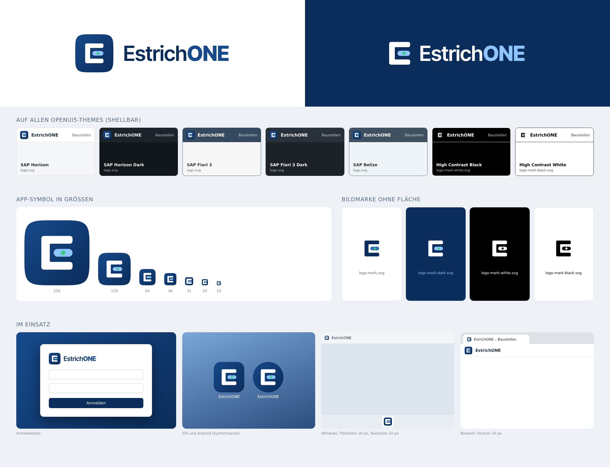

# EstrichONE – Logo und Markenzeichen

## Idee: das Libellen-E

Das Zeichen ist ein „E“ aus dem Estrichaufbau: der obere Arm ist die glatt abgezogene Estrichoberfläche,
der untere die tragende Decke, der Rücken der Randdämmstreifen. Der Mittelstrich ist die **Libelle einer
Wasserwaage** mit grüner Blase – eben und belegreif, das Versprechen jedes Estrichbetriebs.
Die Form ist ein reines Monogramm im 100er-Raster und bleibt bis 16 px als „E“ lesbar.

Vier Konzepte wurden verglichen, siehe [concepts/overview.png](concepts/overview.png); gewählt wurde A.

## Farben

| Name | Wert | Verwendung |
|---|---|---|
| Estrich-Navy | `#0B2D5B` | Primärfarbe, Kachel (Verlauf unten rechts), Schrift „Estrich“ auf hell |
| Navy hell | `#174A8B` | Kachel (Verlauf oben links), Schrift „ONE“ auf hell |
| Libellenblau | `#2F6DB5` | Libelle der Bildmarke auf hellen Flächen (**neu**) |
| Himmelblau | `#8EC5FF` | Libelle auf dunklen Flächen und in der Kachel, „ONE“ auf dunkel |
| Blasengrün | `#3CCB7F` | Blase, sparsamer Akzent (Status „bereit“, Hervorhebung) |
| Weiß | `#FFFFFF` | E in der Kachel, Schrift auf dunkel |

Die bisherigen Werte (`#0B2D5B`, `#174A8B`, `#3CCB7F`, `#8EC5FF`) bleiben unverändert gültig; neu ist nur
`#2F6DB5` für die freistehende Bildmarke auf hellem Grund. Kachelverlauf: linear 135° von `#174A8B` nach `#0B2D5B`.

## Schrift der Wortmarke

**Inter Tight** (SIL Open Font License 1.1): „Estrich“ SemiBold 600, „ONE“ ExtraBold 800, Laufweite −12/1000 em.
Die Wortmarke liegt in allen SVGs als Pfade vor – keine Abhängigkeit von installierten Schriften.
Die Schriftdateien und Lizenzen liegen in `fonts/` (nur für die Erzeugung).

## Dateien

| Datei | Zweck |
|---|---|
| `logo.svg` | App-Symbol, abgerundete Kachel (Superellipse) – Web, Desktop, ShellBar auf allen Nicht-HC-Themes |
| `logo-small.svg` | Kleinform für 16–32 px (auf das 16-px-Pixelraster gelegt, ohne Blase) – `favicon.svg`, ICO 16/24/32 |
| `logo-square.svg` | App-Symbol vollflächig ohne Rundung – iOS/Android maskieren selbst |
| `logo-mark.svg` | Bildmarke transparent, farbig, für helle Flächen |
| `logo-mark-dark.svg` | Bildmarke transparent, farbig, für dunkle Flächen |
| `logo-mark-white.svg` / `logo-mark-black.svg` | Bildmarke einfarbig (High Contrast, Prägung, Stempel) |
| `logo-horizontal.svg` | Kachel + Wortmarke, für helle Flächen |
| `logo-horizontal-white.svg` | Bildmarke + Wortmarke, für dunkle Flächen |
| `logo-horizontal-mono-black.svg` / `-mono-white.svg` | Lockup einfarbig |
| `png/` | Vorschauen (`logo-512/1024.png`, `logo-horizontal*.png`, `presentation.png`) |
| `concepts/` | Konzeptentwürfe und Vergleichstafel `overview.png` |

### Erzeugte Plattform-Dateien (`./build.sh`)

- Web `web/public/`: `favicon.ico` (16/32/48), `favicon.svg` (= `logo-small.svg`), `apple-touch-icon.png` (180, ohne Alpha),
  `icon-192.png`, `icon-512.png`, `logo.svg`, `logo-mark*.svg`, `logo-horizontal*.svg`
- Windows `desktop/src/EstrichOne.Desktop/Assets/`: `EstrichONE.ico` (16–256), `logo.png` (256, Kachel), `logo-mark.png` (64, Bildmarke für hell)
- iOS `AppIcon.appiconset/AppIcon.png` (1024, ohne Alpha)
- Android `res/drawable/ic_launcher_{foreground,background,monochrome}.xml` (adaptiv, 108 dp; das E liegt im sicheren 66-dp-Kreis)

`./build.sh --concepts` erzeugt zusätzlich die Vergleichstafel. Benötigt: Python 3 mit `fonttools` und `uharfbuzz`,
Chromium (`CHROME=` oder Playwright-Pfad), ImageMagick. Alle SVGs entstehen aus `tools/final.py` – dort ändern, nicht in den SVGs.

## OpenUI5-Themes

| Theme | ShellBar | Anmeldeseite / Ladebildschirm |
|---|---|---|
| Horizon, Horizon Dark, Fiori 3, Fiori 3 Dark, Belize | `logo.svg` (Kachel funktioniert auf hellem und dunklem Grund) | `logo-horizontal.svg` auf hell, `logo-horizontal-white.svg` auf dunkel |
| High Contrast Black (`sap_*_hcb`) | `logo-mark-white.svg` | `logo-horizontal-mono-white.svg` |
| High Contrast White (`sap_*_hcw`) | `logo-mark-black.svg` | `logo-horizontal-mono-black.svg` |

## Schutzzone und Mindestgrößen

- Schutzzone rund um jedes Logo: **¼ der Kachelhöhe** (im Lockup also 25 % der Logohöhe). Darin keine Texte, Kanten oder Bilder.
- Kachel/App-Symbol: mindestens 16 px (unter 48 px die Kleinform `logo-small.svg` verwenden).
- Freistehende Bildmarke: mindestens 16 px Höhe.
- Horizontales Logo: mindestens 24 px Höhe (Bildschirm) bzw. 8 mm (Druck); darunter nur das Symbol.

## Do / Don't

**Do**
- Dateien unverändert verwenden; Größe nur proportional ändern.
- Auf dunklen Flächen die `-white`/`-dark`-Varianten, in High-Contrast-Themes die einfarbigen nehmen.
- Ausreichend Kontrast: Kachel auf Flächen heller als `#2A3F5A` oder dunkler als `#0E1726` problemlos.

**Don't**
- Kein Verzerren, Drehen, Schatten, Leuchten oder Umranden.
- Farben nicht austauschen, die Blase nicht in anderen Farben einfärben (außer einfarbige Varianten).
- Wortmarke nicht in anderer Schrift nachsetzen, „ONE“ nicht klein schreiben.
- Das E nicht ohne Libelle verwenden und die Kachel nicht mit eckigen Ecken nachbauen (iOS/Android maskieren selbst).
- Farbige Bildmarke nicht auf unruhige Fotos stellen – dann die Kachel verwenden.
