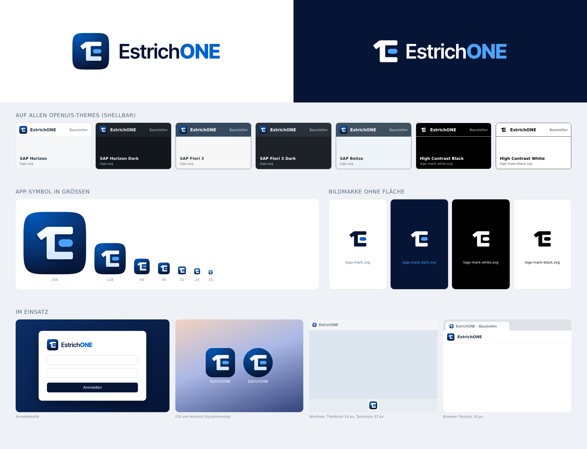

# EstrichONE – Logo und Markenzeichen

## Idee: das E1-Monogramm (Runde 2)

Ein „E“, dessen Rücken oben den Anstrich einer **„1“** trägt – *Estrich* und *ONE* in einem Zeichen.
Der Mittelstrich ist als Kapsel abgesetzt: die **Libelle** der Wasserwaage, das Ausgleichen, das Ebene.
Raster 100 × 100, Flaggenwinkel 37° (4 : 3), Rücken 13, Arme und Flagge 12, Außenecken 3,5, Innenecken 1,5;
optischer Ausgleich +3 nach rechts (die Flagge ist leichter als der Rücken). Für 16/32 px gibt es eine
eigene, auf das 16-px-Pixelraster gelegte Kleinform (`logo-small.svg`).

Konzepte: Runde 2 in [concepts/overview-v2.png](concepts/overview-v2.png) (sechs Richtungen, gewählt C),
Runde 1 (Libellen-E, abgelöst) in [concepts/overview.png](concepts/overview.png).

## Farben – NEU in Runde 2

> **Geändert:** Die Markenfarben sind jetzt Nachtblau + **eine Akzentfarbe Markenblau** (passend zur
> AccentColor der Apps). Das bisherige Navy `#0B2D5B`/`#174A8B`, Himmelblau `#8EC5FF` und das Grün `#3CCB7F`
> gehören **nicht mehr** zum Logo.

| Name | Wert | Verwendung |
|---|---|---|
| Nachtblau | `#061536` | Kachel (Verlauf unten), Zeichen und „Estrich“ auf hellem Grund |
| Nachtblau hell | `#0B2E66` | Kachel (Verlauf oben), Android-Hintergrund |
| **Markenblau** | `#0062CC` | Akzent: Libelle auf hell, „ONE“ auf hell, Licht in der Kachel (= AccentColor hell) |
| Markenblau hell | `#4DA3FF` | Libelle und „ONE“ auf dunklem Grund (= AccentColor dunkel) |
| Eis | `#CFE5FF` | Verlaufsende des Zeichens in der Kachel |
| Weiß | `#FFFFFF` | Zeichen in der Kachel, Schrift auf dunkel |

Kachel: linearer Verlauf von oben `#0B2E66` nach unten `#061536`, darüber ein radiales Markenblau-Licht von oben
links, eine feine Glanzkante oben und ein weicher Schatten unter dem Zeichen (nur App-Symbol, nicht in der Bildmarke).

## Schrift der Wortmarke

**Inter Tight** (SIL Open Font License 1.1): „Estrich“ SemiBold 600, „ONE“ ExtraBold 800, Laufweite −14/1000 em.
Die Wortmarke liegt in allen SVGs als Pfade vor – keine Abhängigkeit von installierten Schriften.
Die Schriftdateien und Lizenzen liegen in `fonts/` (nur für die Erzeugung).

## Dateien

| Datei | Zweck |
|---|---|
| `logo.svg` | App-Symbol, abgerundete Kachel (Superellipse) – Web, Desktop, ShellBar auf allen Nicht-HC-Themes |
| `logo-small.svg` | Kleinform für 16–32 px (auf das 16-px-Pixelraster gelegt, ohne Glanz und Schatten) – `favicon.svg`, ICO 16/24/32 |
| `logo-square.svg` | App-Symbol vollflächig ohne Rundung – iOS/Android maskieren selbst |
| `logo-mark.svg` | Bildmarke transparent, farbig, für helle Flächen |
| `logo-mark-dark.svg` | Bildmarke transparent, farbig, für dunkle Flächen |
| `logo-mark-white.svg` / `logo-mark-black.svg` | Bildmarke einfarbig (High Contrast, Prägung, Stempel) |
| `logo-horizontal.svg` | Kachel + Wortmarke, für helle Flächen |
| `logo-horizontal-white.svg` | Bildmarke + Wortmarke, für dunkle Flächen |
| `logo-horizontal-mono-black.svg` / `-mono-white.svg` | Lockup einfarbig |
| `png/` | Vorschauen (`logo-512/1024.png`, `logo-horizontal*.png`, `presentation-v2.png`) |
| `concepts/` | Konzeptentwürfe: Runde 1 `overview.png`, Runde 2 `v2/` und `overview-v2.png` |

### Erzeugte Plattform-Dateien (`./build.sh`)

- Web `web/public/`: `favicon.ico` (16/32/48), `favicon.svg` (= `logo-small.svg`), `apple-touch-icon.png` (180, ohne Alpha),
  `icon-192.png`, `icon-512.png`, `logo.svg`, `logo-mark*.svg`, `logo-horizontal*.svg`
- Windows `desktop/src/EstrichOne.Desktop/Assets/`: `EstrichONE.ico` (16–256), `logo.png` (256, Kachel), `logo-mark.png` (64, Bildmarke für hell)
- iOS `AppIcon.appiconset/AppIcon.png` (1024, ohne Alpha), `BrandMark.imageset` (`logo-mark.svg`, dunkel: `logo-mark-dark.svg`), `BrandMarkOnDark.imageset` (`logo-mark-dark.svg`)
- Android `res/drawable/ic_launcher_{foreground,background,monochrome}.xml` (adaptiv, 108 dp; weitester Punkt 27 dp vom Mittelpunkt, also im sicheren 66-dp-Kreis)

`./build.sh --concepts` erzeugt zusätzlich die Vergleichstafeln. Benötigt: Python 3 mit `fonttools` und `uharfbuzz`,
Chromium (`CHROME=` oder Playwright-Pfad), ImageMagick. Alle SVGs entstehen aus `tools/final.py` – dort ändern, nicht in den SVGs.

## OpenUI5-Themes

| Theme | ShellBar | Anmeldeseite / Ladebildschirm |
|---|---|---|
| Horizon, Horizon Dark, Fiori 3, Fiori 3 Dark, Belize | `logo.svg` (Kachel funktioniert auf hellem und dunklem Grund) | `logo-horizontal.svg` auf hell, `logo-horizontal-white.svg` auf dunkel |
| High Contrast Black (`sap_*_hcb`) | `logo-mark-white.svg` | `logo-horizontal-mono-white.svg` |
| High Contrast White (`sap_*_hcw`) | `logo-mark-black.svg` | `logo-horizontal-mono-black.svg` |

## Schutzzone und Mindestgrößen

- Schutzzone rund um jedes Logo: **¼ der Kachelhöhe** (im Lockup also 25 % der Logohöhe). Darin keine Texte, Kanten oder Bilder.
- Kachel/App-Symbol: mindestens 16 px (unter 48 px die Kleinform `logo-small.svg` verwenden).
- Freistehende Bildmarke: mindestens 16 px Höhe.
- Horizontales Logo: mindestens 24 px Höhe (Bildschirm) bzw. 8 mm (Druck); darunter nur das Symbol.

## Do / Don't

**Do**
- Dateien unverändert verwenden; Größe nur proportional ändern.
- Auf dunklen Flächen die `-white`/`-dark`-Varianten, in High-Contrast-Themes die einfarbigen nehmen.
- Auf sehr dunklem Nachtblau-Grund die freistehende Bildmarke (`logo-mark-dark.svg`) statt der Kachel verwenden.

**Don't**
- Kein Verzerren, Drehen, Schatten, Leuchten oder Umranden.
- Farben nicht austauschen; die Libelle ist immer Markenblau (außer in den einfarbigen Varianten). Kein Grün.
- Wortmarke nicht in anderer Schrift nachsetzen, „ONE“ nicht klein schreiben.
- Die Flagge der „1“ nie abschneiden, das Zeichen nicht ohne Libelle verwenden, die Kachel nicht eckig nachbauen (iOS/Android maskieren selbst).
- Farbige Bildmarke nicht auf unruhige Fotos stellen – dann die Kachel verwenden.
