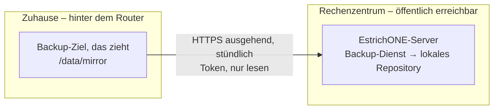
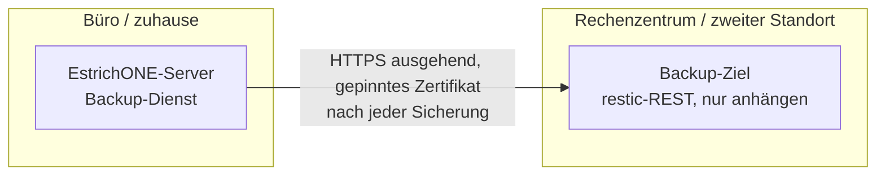

# Datensicherung, Wiederherstellung, Archiv und Wartung

EstrichONE sichert sich selbst: täglich mindestens eine **Vollsicherung** (zusätzlich inkrementell möglich), verschlüsselt
mit [restic](https://restic.net) (AES-256, Prüfsummen über jeden Block), auf ein oder mehrere Ziele. Alles Nötige steht im
**Backup Center** der Weboberfläche (System → Sicherung, Recht `backup.manage`). Fällt der Backup-Server aus, sehen alle
Benutzer in Web und Apps ein rotes Banner; Administratoren bekommen nach jeder Sicherung eine Pushnachricht.

## Auf einen Blick

| Frage | Antwort |
|---|---|
| Wie oft? | Täglich eine **Vollsicherung** (Standard 22:30 Uhr, alle Dateien werden neu gelesen und geprüft), optional zusätzlich **inkrementell** alle 1–12 Stunden. Einstellbar im Backup Center → *Zeitplan und Meldungen*. |
| Was? | Datenbank (alle Fachdaten, Benutzer, Archiv-Nachweise), alle Dateien (Fotos, Dokumente, Videos, Pläne, Vorschaubilder), Schlüsselbund (`.keys`: Anmeldungen, verschlüsselte Push-/APNs-/VAPID-Schlüssel), Server-Konfiguration (`.env`-Kopie), Zeitplan, Backup-Ziele. |
| Wohin? | Hauptziel (Ordner/zweite Platte/NAS, `sftp:`), optional zweites Ziel, beliebig viele **Backup-Ziele auf anderer Hardware** (Kopplungscode, nur anhängen) und **Backup-Ziele, die ziehen** (zuhause hinter NAT). |
| Wie sicher? | restic: AES-256 + Poly1305 je Block, Prüfsummen (SHA-256), Repository-Passwort nur beim Betrieb und auf dem Notfallblatt. Sonntags `restic check` (10 % Daten) und Probe-Wiederherstellung in eine temporäre Datenbank. |
| Aufbewahrung | Standard 14 täglich / 8 wöchentlich / 12 monatlich / 3 jährlich (lokales Hauptziel); Backup-Ziele behalten alles (nur anhängen). |
| Zurückspielen | Backup Center → *Sicherungen* → **Wiederherstellen** (ganzes System, mit Bestätigung und Sperre) oder **Datei …** (eine Datei). |
| Totalverlust | Ein Befehl auf neuem Server: Installer-Modus **`restore`** (siehe [Worst Case](#worst-case-server-komplett-ausgefallen)). |
| Überwachung | Rotes Banner bei Ausfall des Backup-Servers, gelbes beim Archivserver – in Web und Apps; Push an Admins nach jeder Sicherung. |

## Topologien

Jede Sicherung geht immer zuerst an das **Hauptziel** (Ordner auf dem Server bzw. eingebundene Platte). Für den Schutz
vor Brand, Diebstahl und Verschlüsselungstrojanern kommt mindestens ein **zweiter Standort** dazu. Welche Richtung die
Verbindung nimmt, hängt davon ab, wer von wem erreichbar ist:

### A) Hauptserver im Rechenzentrum, Backup-Server zuhause (hinter NAT, ohne feste IP) – „Ziel zieht“



Das Ziel verbindet sich **ausgehend** – keine Portfreigabe, keine feste IP, kein VPN. Es holt nur neue, verschlüsselte
Dateien des Repositorys, prüft jede gegen ihren SHA-256-Namen und löscht nie etwas. Den Schlüssel zum Entschlüsseln
kennt es nicht.

1. Backup Center → *Backup-Ziele* → **Ziel, das zieht, hinzufügen** → Bezeichnung → zeigt Code (24 h, einmal) und Befehl.
2. Auf dem Rechner zuhause (Linux mit Docker, z. B. NAS, Mini-PC, Raspberry Pi):
   ```bash
   sudo docker run --rm -v /var/run/docker.sock:/var/run/docker.sock \
     -e ESTRICHONE_PULL_FROM=https://estrichone.firma.de -e ESTRICHONE_PULL_CODE=ABCD-EFGH-JKLM-NPQR \
     ghcr.io/florians25/estrichone-installer:<version> backup-ziel
   ```
   Optional: `-e ESTRICHONE_DATA_DIR=/srv/estrichone-backup` (Ordner statt Docker-Volume), `-e ESTRICHONE_PULL_INTERVAL_MINUTES=30`,
   `-e ESTRICHONE_PULL_FINGERPRINT=<SHA-256>` (wenn der Server ein eigenes statt eines öffentlichen Zertifikats hat).
3. Im Backup Center erscheint das Ziel mit „Verbunden“, Anzahl der Sicherungsstände, Platz. Meldet es sich 3 Stunden nicht,
   wird es rot (Banner, Push an Admins).

Voraussetzung: Hauptziel ist der lokale Ordner (`BACKUP_REPOSITORY=/repository`, Standard) – die API stellt ihn nur lesend
und nur mit Spiegel-Token unter `/api/v1/backup/mirror/…` bereit.

### B) Hauptserver zuhause/im Büro, Backup-Server im Rechenzentrum – „Server schiebt“



1. Auf dem Zielrechner: `sudo docker run --rm -v /var/run/docker.sock:/var/run/docker.sock ghcr.io/florians25/estrichone-installer:<version> backup-ziel`
   → zeigt Adresse, **Kopplungscode** und Fingerabdruck (Port 8444 freigeben bzw. im RZ erreichbar).
2. Backup Center → *Backup-Ziele* → **Backup-Ziel koppeln** → Adresse + Code. Fingerabdruck vergleichen.
3. Jede Sicherung geht ab sofort zusätzlich dorthin („nur anhängen“: der Server kann dort nichts löschen).

Dasselbe gilt für ein Backup-Ziel im **gleichen Netz** (zweites Gebäude, NAS im Keller).

### C) Archivserver – beide Richtungen

Der Archivserver (revisionssicheres Archiv, [deploy/archive/README.md](../deploy/archive/README.md)) wird vom
EstrichONE-Server aus angesprochen (Kopplungscode, gepinntes Zertifikat):

| Lage | Einrichtung |
|---|---|
| Archiv im selben Netz oder im RZ, Hauptserver zuhause | Standard: `… installer:<version> archiv` auf dem Archivrechner, in EstrichONE *System → Archiv → Archivserver koppeln*. |
| Hauptserver im RZ, Archiv zuhause hinter NAT | Port 8443 (TCP) am Router auf den Archivrechner weiterleiten und eine DynDNS-Adresse verwenden, oder beide per WireGuard/Tailscale verbinden und die Tunnel-Adresse koppeln. Die Verbindung ist durch das gepinnte Zertifikat und das Kopplungs-Token geschützt; der Archivserver nimmt nur Anfragen gekoppelter Clients an. |
| Kein zweiter Rechner | Archiv im Stack (`-e ESTRICHONE_ARCHIVE=lokal`) – nur als Übergang, ein Archiv gehört auf eigene Hardware. |

Fällt der Archivserver aus, hält EstrichONE die Dokumente zurück und überträgt sie später; Benutzer sehen das gelbe Banner.

## Zeitplan, Aufbewahrung, Meldungen

Backup Center → *Zeitplan und Meldungen* (`GET/PUT /api/v1/backup/settings`, Recht `backup.manage`):

```json
{ "dailyTime": "22:30", "incrementalEveryHours": 0, "keepDaily": 14, "keepWeekly": 8, "keepMonthly": 12, "keepYearly": 3,
  "notifyAdmins": true, "notifyOnSuccess": true, "weeklyRestoreTest": true }
```

Der Backup-Dienst liest die Werte vor jedem Takt (`data/backup-status/settings.env`). `.env`-Werte (`BACKUP_TIME`, `KEEP_*`)
gelten nur, solange im Backup Center nichts gespeichert wurde.

## Wiederherstellen im Backup Center

*Sicherungen* listet jede Sicherung je Quelle (Hauptziel, zweites Ziel, Backup-Ziele) mit Zeitpunkt, Art (Voll/inkrementell),
Dateien und Umfang (`GET /api/v1/backup/snapshots`).

- **Wiederherstellen (ganzes System):** Bestätigung „WIEDERHERSTELLEN“. Ablauf (`POST /api/v1/backup/restore`
  `{snapshot, source, scope:"full", confirmation}`, Fortschritt `GET /api/v1/backup/restore`):
  1. Sperre für **alle** (auch Administratoren): API antwortet `503` `MAINTENANCE` (`reason: restore`).
  2. Sicherung prüfen (`restic check`, Stichprobe) – bei Fehlern bricht es ab, ohne etwas zu ändern.
  3. Datenbank in eine **neue** Datenbank einspielen, dann tauschen. Die bisherige bleibt als
     `estrichone_vor_wiederherstellung` erhalten (bis zur nächsten Wiederherstellung) – ein Fehler unterwegs ändert nichts.
  4. Dateien zurückspielen (Schlüsselbund wird nur ergänzt), Zeitplan zurück.
  5. API bringt das Datenbankschema auf den Stand ihrer Version und gibt frei. Neue `instanceEpoch` → Apps gleichen neu ab;
     alle melden sich neu an.
- **Datei …:** eine Datei (Original + Vorschaubilder) per Datei-ID aus der gewählten Sicherung zurückholen
  (`scope:"file", fileId`). Keine Sperre.

Grenze: Eine einzelne **Bauakte** (Datenbankzeilen) lässt sich nicht getrennt zurückspielen – dafür das ganze System auf
einen Stand zurücksetzen oder die Bauakte aus der Reserve-Datenbank `estrichone_vor_wiederherstellung` nachtragen lassen.

Von der Konsole (z. B. ohne Weboberfläche):

```bash
cd /opt/estrichone
sudo docker compose -p estrichone exec backup estrichone-backup snapshots        # Sicherungen auflisten
sudo docker compose -p estrichone stop api
sudo docker compose -p estrichone --profile restore run --rm restore <snapshot>   # oder latest
sudo docker compose -p estrichone up -d
```

## Worst Case: Server komplett ausgefallen

Voraussetzungen: **Notfallblatt** (Backup Center → *Notfall* → *Notfallblatt (PDF)*, ausgedruckt im Tresor) und eine
erreichbare Sicherung: Backup-Ziel (Zugang + Fingerabdruck stehen auf dem Blatt), zweites Ziel (`sftp:`) oder eine Kopie
des Repository-Ordners (USB-Platte, Spiegel von zuhause: `sudo docker cp estrichone-backup-target:/data/mirror ./estrichone-backup`).

1. Neuen Linux-Server mit Docker bereitstellen; DNS der Domain auf die neue IP umstellen.
2. USB-Platte bzw. Kopie einbinden, z. B. unter `/mnt/usb/estrichone-backup`.
3. Ein Befehl:
   ```bash
   sudo mkdir -p /opt/estrichone && sudo docker run --rm -it -v /var/run/docker.sock:/var/run/docker.sock \
     -v /opt/estrichone:/opt/estrichone -v /mnt:/mnt ghcr.io/florians25/estrichone-installer:<version> restore
   ```
   Der Installer fragt:
   - **Quelle:** Ordner (`/mnt/usb/estrichone-backup`) oder Zugang vom Notfallblatt (`rest:https://…`, `sftp:…`),
   - **Fingerabdruck** (nur bei `rest:https://…`: das Zertifikat des Backup-Ziels wird geholt und gegen den Fingerabdruck geprüft),
   - **Wiederherstellungsschlüssel** (wie vom Blatt, Leerzeichen egal).

   Ohne Rückfragen: `-e ESTRICHONE_RESTORE_FROM=… -e ESTRICHONE_RESTORE_FINGERPRINT=… -e ESTRICHONE_BACKUP_PASSWORD=…`,
   neue Adresse optional `-e ESTRICHONE_DOMAIN=…`, bestimmter Stand `-e ESTRICHONE_RESTORE_SNAPSHOT=<id>`.
4. Er holt die `.env` aus der neuesten Sicherung (Domain, Passwörter, Push-Einstellungen), richtet den Stack ein, spielt
   Datenbank, Dateien, Schlüsselbund und Zeitplan ein, startet EstrichONE und meldet „Wiederherstellung abgeschlossen“.
5. Anmelden wie bisher. Im Backup Center: Backup-Ziele prüfen (ggf. neu koppeln), **neues Notfallblatt drucken**. Das
   lokale Hauptziel des neuen Servers beginnt leer – wer die alte Historie behalten will, kopiert den Repository-Ordner
   vor Schritt 3 nach `/opt/estrichone/backup-repository` (Eigentümer UID 1654).

In der CI getestet (`deploy/backup/test-installer-restore.sh`, Workflow *Infrastruktur*): Installation → Bauakte, Foto,
Einstellungen → Sicherung → Kopie → Server samt `/opt/estrichone` gelöscht → `installer restore` → Anmeldung, Bauakte,
Foto (SHA-256), Einstellungen, `.env` und neue `instanceEpoch` geprüft; danach ein Backup-Ziel, das zieht, gekoppelt und
dessen Spiegel mit `restic check --read-data` vollständig geprüft. Wiederherstellung im laufenden System (ganzes System und
Datei, mit Sperre) und Totalverlust per Dienst `restore`: `deploy/backup/test-backup-restore.sh` (Workflow *Backend*).

## Zusatzserver aktualisieren (Fernaktualisierung)

Backup-Ziele, Backup-Ziele, die ziehen, und der Archivserver laufen auf eigener Hardware. Sie lassen sich vom Hauptserver
aus aktualisieren – ohne Anmeldung am jeweiligen Rechner:

- **Weboberfläche** (Recht `backup.manage`): *System → Backup-Ziele* (Abschnitt „Aktualisierung der Zusatzserver“) bzw.
  *System → Archiv*. Je Rechner: installierte Version, verfügbare Version (= Version dieses Servers), Stand des letzten
  Auftrags, Knopf **Aktualisieren** sowie **Alle aktualisieren**, Schalter **automatisch mitaktualisieren**.
- **Nach einem Update des Hauptservers** prüft der Server binnen weniger Minuten (danach stündlich) alle Zusatzserver:
  Rechner mit „automatisch mitaktualisieren“ werden beauftragt, für die übrigen bekommen die Administratoren einmal je
  Version die Benachrichtigung `peer.update_available` mit Link auf die Seite.

### Ablauf und Sicherheit

1. Der Server erteilt einen **Auftrag mit nur einer Versionsnummer**. Erlaubt sind ausschließlich gültige
   Versionsnummern (SemVer, z. B. `0.1.0-preview.23`) **bis einschließlich der eigenen Version**; Tags wie `latest`,
   Image-Namen oder Optionen werden abgelehnt (422). Der Auftrag ist per HMAC-SHA-256 signiert (Schlüssel: SHA-256 des
   Kopplungs-Tokens, gebunden an Rolle, Kopplung, Auftrags-ID, Zielversion und Serverversion) und gilt 10 Minuten.
2. **Zustellung:** an Backup-Ziele und den Archivserver über die bestehende gekoppelte Verbindung mit gepinntem Zertifikat
   (`POST /api/v1/update` am Zusatzserver, Bearer-Token der Kopplung). Ein **Ziel, das zieht**, holt den Auftrag selbst ab:
   es meldet sich alle 2 Minuten ausgehend (`POST /backup/mirror/checkin`, Bearer-Spiegel-Token) – keine Portfreigabe nötig.
3. Der Zusatzserver prüft Signatur, Alter, Version (nicht neuer als der Server, **nicht älter als installiert** – Zurückstufen
   nur am Rechner selbst) und legt die Versionsnummer in das Volume `estrichone-<rolle>-update`. Der Dienst selbst hat
   weiterhin weder Shell noch Docker-Zugriff.
4. Der **Updater** daneben (Container `estrichone-<rolle>-updater`, Installer-Image mit Docker-Socket) startet den
   Installer **der Zielversion** im Aktualisierungsmodus. Das Image ergibt sich fest aus Registry und Rolle:
   `ghcr.io/florians25/estrichone-backup-target:<version>` bzw. `…/estrichone-archive:<version>`.
5. Der Installer hält den laufenden Container an (umbenannt in `…-vorher`), startet die neue Version mit **denselben
   Volumes und Optionen** und prüft die Gesundheit (läuft, startet nicht ständig neu, eingebauter Gesundheitstest zweimal
   in Folge, höchstens 120 s). **Gesund** → alter Container wird entfernt, der Updater auf die neue Version gebracht.
   **Nicht gesund** → neuer Container weg, vorige Version läuft wieder (**Rücksprung**, Daten unverändert).
6. Ergebnis (`succeeded`, `rolled_back`, `failed` mit Meldung) geht beim nächsten Abruf (alle 30 s) bzw. beim nächsten
   Melden des ziehenden Ziels an den Server. Ohne Rückmeldung nach 30 Minuten gilt der Auftrag als fehlgeschlagen.

Protokoll: jeder Auftrag und jedes Ergebnis im Audit (`peer.update.requested`, `peer.update.succeeded`,
`peer.update.rolled_back`, `peer.update.failed`, `peer.update.auto_changed`). Benachrichtigungen an alle mit
`backup.manage`: `peer.update_succeeded` (Erfolg) und `peer.update_failed` (Fehler oder Rücksprung, Pflicht-Ereignis) –
siehe docs/benachrichtigungen.md.

### Einmalig: bestehende Zusatzserver umstellen

Rechner, die vor dieser Version eingerichtet wurden, haben noch keinen Updater. **Einmal am Rechner selbst** den
Installer der aktuellen Version mit denselben Optionen wie bei der Einrichtung ausführen, z. B.:

```bash
sudo docker run --rm -v /var/run/docker.sock:/var/run/docker.sock ghcr.io/florians25/estrichone-installer:<version> backup-ziel
sudo docker run --rm -v /var/run/docker.sock:/var/run/docker.sock ghcr.io/florians25/estrichone-installer:<version> archiv
# Ziel, das zieht: wie bei der Einrichtung zusätzlich -e ESTRICHONE_PULL_FROM=https://… (Code nicht mehr nötig)
```

Die Weboberfläche zeigt den passenden Befehl, solange ein Rechner keinen Updater meldet. Danach geht jedes weitere
Update per Knopfdruck. Abschalten: `-e ESTRICHONE_REMOTE_UPDATE=aus` (der Updater-Container wird entfernt). Am Rechner
selbst aktualisieren geht weiterhin (Installationsbefehl erneut ausführen – ebenfalls mit Rücksprung bei Fehlern).

Hinweis: Der Updater hat – wie der Installer – Zugriff auf den Docker-Socket dieses Rechners. Er nimmt aber nur die
Versionsnummer aus dem Auftrag; was gestartet wird, legen der Installer und die beim Einrichten gewählten Optionen fest.

In der CI getestet (`deploy/backup-target/test-remote-update.sh`, Workflow *Infrastruktur*): Backup-Ziel mit alter
Test-Version einrichten und koppeln, sichern → ungültige/zu neue Versionen abgelehnt → Update auf eine Version, die nie
gesund wird → Rücksprung → Update auf die CI-Version → gesund, Sicherungen und Kopplung erhalten, erneute Sicherung,
Benachrichtigungen; danach dasselbe für ein Ziel, das zieht.

## Notfallblatt

`GET /api/v1/backup/emergency-sheet` (PDF, Recht `backup.manage`, im Audit protokolliert): Betrieb, Server-Adresse, Version,
**Wiederherstellungsschlüssel** (Repository-Passwort in Viererblöcken), alle Sicherungsziele mit Zugang und Fingerabdruck,
der Befehl für die Neuinstallation und die Schritte oben. Neu drucken, wenn ein Backup-Ziel dazukommt oder sich ändert.
Je gekoppeltem Backup-Ziel gibt es zusätzlich den Notfallzugang als Text (`/backup/targets/{id}/recovery`).

## API des Backup Centers (Recht `backup.manage`)

| Methode | Pfad | Zweck |
|---|---|---|
| GET | `/backup/status` | Zustand, letzte Läufe, Prüfung, Probe-Wiederherstellung |
| POST | `/backup/run` | Vollsicherung anfordern (startet binnen 30 s) |
| GET/PUT | `/backup/settings` | Zeitplan, Aufbewahrung, Meldungen |
| GET | `/backup/snapshots` | Sicherungen je Quelle |
| POST | `/backup/restore` | Wiederherstellen (`scope` `full`/`file`) |
| GET | `/backup/restore` | Fortschritt (`status` `requested`→`running`→`restored`→`completed` bzw. `failed`; 204 = nie) |
| GET | `/backup/emergency-sheet` | Notfallblatt (PDF) |
| GET/POST/DELETE | `/backup/targets…` | Backup-Ziele koppeln/entfernen, Notfallzugang |
| GET/POST/DELETE | `/backup/mirrors…` | Backup-Ziele, die ziehen (Code + Befehl) |
| GET | `/backup/peer-updates` | Zusatzserver: installierte/verfügbare Version, Updater, letzter Auftrag (`?live=false` ohne Abfrage) |
| POST | `/backup/peer-updates/{key}/update` | Aktualisieren (`{ "version": null }` = Version dieses Servers); 202, 409 läuft schon, 422 Version |
| POST | `/backup/peer-updates/update-all` | alle veralteten Zusatzserver mit Updater (optional `?kind=archive`) |
| PUT | `/backup/peer-updates/{key}/auto` | `{ "autoUpdate": true }` – nach Updates des Servers automatisch mitaktualisieren |
| GET | `/system/monitoring` | Platten, Trends, Dienste aller Systeme |

Protokoll für ziehende Ziele (Bearer-Spiegel-Token, nicht für Menschen): `POST /backup/mirror/pair`, `GET /backup/mirror/repo/config`,
`GET /backup/mirror/repo/{keys|snapshots|index|data}/[name]`, `POST /backup/mirror/report`, `POST /backup/mirror/checkin`
(Version, Stand der Aktualisierung; Antwort `{ order }` mit signiertem Auftrag oder `null`).

## Status-Banner und Wartung für alle Clients (Web-Shell, iOS, Android)

### `GET /api/v1/system/health-banner` (angemeldet, jedes Recht)

Zwischengespeichert bis 10 Minuten (der Server prüft jede Minute selbst) – Clients fragen alle 5 Minuten und nach dem
Start bzw. Wiederverbinden. Auch während einer Wartung erreichbar.

```json
{
  "backup":  { "configured": true, "reachable": false, "lastSuccessAt": "2026-10-26T21:30:12Z", "severity": "critical",
               "message": "ACHTUNG: Backup-Server ausgefallen oder nicht erreichbar (Letztes Backup 26.10.2026 22:30 Uhr). Bitte geben Sie umgehend Ihrem Admin Bescheid.",
               "restoreRunning": false },
  "archive": { "configured": true, "reachable": false, "lastSuccessAt": "2026-10-27T08:02:00Z", "severity": "warning",
               "message": "Hinweis: Archiv-Server ausgefallen oder nicht erreichbar (Letzte Archivierung 27.10.2026 09:02 Uhr). Bitte informieren Sie Ihren Admin." },
  "banners": [
    { "key": "backup",  "severity": "critical", "text": "ACHTUNG: Backup-Server ausgefallen …" },
    { "key": "archive", "severity": "warning",  "text": "Hinweis: Archiv-Server ausgefallen …" }
  ],
  "checkedAt": "2026-10-27T21:31:00Z"
}
```

Clients zeigen **genau `banners`** an (Reihenfolge = Wichtigkeit, `critical` rot, `warning` gelb, Text unverändert);
leeres Array = kein Banner. Regeln auf dem Server:

| Banner | Bedingung |
|---|---|
| rot `backup` | Backup **eingerichtet** (gekoppeltes Backup-Ziel bzw. Ziel, das zieht, oder mindestens eine erfolgreiche Sicherung) **und** (ein Ziel nicht erreichbar, letzter Lauf fehlgeschlagen oder letzte erfolgreiche Sicherung älter als 26 Stunden). Nicht während einer Wiederherstellung. |
| gelb `archive` | Archivserver gekoppelt **und** nicht erreichbar. |

Zusätzlich benachrichtigt der Server alle Benutzer mit Recht `backup.manage` (Postfach + Push, Kategorie `system`):
beim Ausfall einmal, danach einmal täglich als Erinnerung, und „wieder in Ordnung“, sobald es behoben ist.

### Wartungsmodus sperrt alle Clients (B7)

Während einer Wartung (Einstellungen → Systemhinweise bzw. Hosting-Konsole) beantwortet die API
**jeden** fachlichen Aufruf von Nicht-Administratoren – auch Sync, Uploads, Planung – mit

```http
HTTP/1.1 503 Service Unavailable
Retry-After: 1800
Content-Type: application/problem+json

{ "title": "Wartungsarbeiten", "detail": "EstrichONE wird auf Version 0.1.0 aktualisiert.", "status": 503,
  "code": "MAINTENANCE", "reason": "maintenance", "startsAt": "2026-10-28T18:00:00Z", "endsAt": "2026-10-28T18:30:00Z",
  "adminsMayWork": true }
```

- `reason` = `maintenance` (geplante Wartung) oder `restore` (Wiederherstellung aus dem Backup Center – dann sind auch
  Administratoren gesperrt, `endsAt` ist `null`).
- Erreichbar bleiben: `/server-info`, `/auth/*`, `/setup`, `/system/notices`, `/system/health-banner`.
- **Apps (iOS/Android):** bei `503` + `code = MAINTENANCE` Sperrbildschirm mit `title`, `detail`, `endsAt`
  („voraussichtlich bis 18:30 Uhr“); **Outbox nicht verwerfen** – der Server hat nichts übernommen, alles wird nach dem
  Ende erneut gesendet. Freigabe erkennen: `GET /system/notices` (ohne Anmeldung) alle 60 Sekunden bzw. nach
  `Retry-After`; `maintenance` fehlt oder `active = false` → entsperren und Sync anstoßen. Nach einer Wiederherstellung
  ändert sich `instanceEpoch` (`/server-info`) – dann vollständig neu abgleichen (docs/sync-protokoll.md).

### Fallback bei Serverausfall (B8)

Ist die API nicht erreichbar (Neustart, Absturz, Update), liefert Caddy für Seitenaufrufe statt einer Fehlermeldung die
Störungsseite (`/stoerung.html`: Logo, „EstrichONE ist gerade nicht erreichbar“, automatischer Neuversuch alle 30 s);
API-Aufrufe bekommen weiterhin `502/503/504` mit `application/problem+json` und `code = SERVER_UNAVAILABLE`. Während einer
Wartung zeigt die Weboberfläche die Wartungsseite. Der Service Worker der PWA zeigt ohne jede Verbindung die
Offline-Seite (`/stoerung.html` ist vorab zwischengespeichert).
