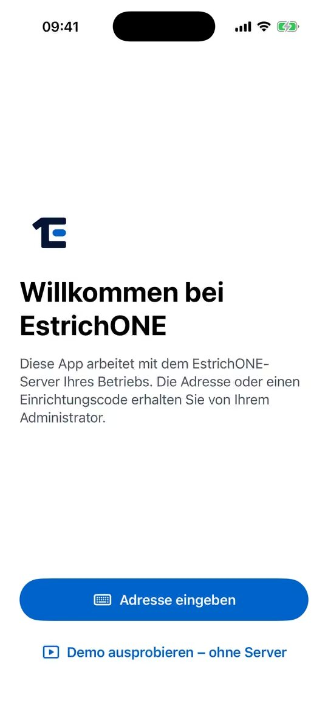
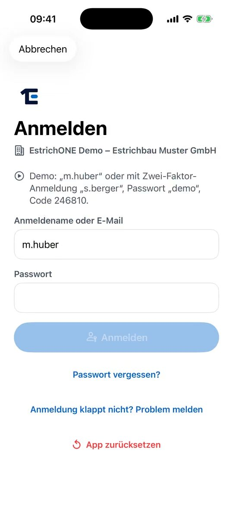

% datei: Kurzanleitung-01-App-einrichten-und-anmelden
% art: Kurzanleitung · App
% fuer: alle, die mit iPhone oder iPad arbeiten – Kolonne, Bauleitung, Büro

# App einrichten und anmelden (QR-Code)

## Das brauchen Sie

- iPhone oder iPad mit **iOS bzw. iPadOS 17** oder neuer, die App **EstrichONE** aus dem App Store (kostenlos).
- Von der Administration: **Anmeldename**, erstes Passwort (Einmalpasswort) und den **QR-Code** zur Einrichtung.

## So geht's

1. App öffnen und **QR-Code scannen** tippen. Kamera auf den QR-Code richten (Abstand 20–40 cm).
2. Prüfen, ob die Adresse stimmt, und **Diesen Server verwenden** tippen.
3. Nutzung wählen: **Persönliches Gerät** (nur Sie) oder **Gemeinsames Gerät (Poolgerät)**, z. B. das iPad im Fahrzeug.
4. **Anmeldename oder E-Mail** und **Passwort** eingeben, **Anmelden** tippen.
5. Ist die Zwei-Faktor-Anmeldung an: den **6-stelligen Code** aus der Authenticator-App eingeben.
6. Beim ersten Mal ein **eigenes Passwort** festlegen (mindestens 12 Zeichen).
7. **Persönliches Gerät:** ab jetzt mit **Face ID** oder Gerätecode entsperren.
   **Poolgerät:** eine **6-stellige PIN** festlegen. Später: Namen antippen, PIN eingeben.

> **Tipp:** Mit QR-Code ist das Gerät sofort freigegeben. Ohne Code (**Adresse eingeben**) zeigt die App
> **Wartet auf Freigabe**, bis die Administration das Gerät freigibt – die App macht dann von selbst weiter.

## Gut zu wissen

- Der QR-Code gilt nur **kurz** und nur **einmal**. Abgelaufen? Neuen Code bei der Administration holen.
- Poolgerät übergeben: **Mehr** → **Benutzer wechseln**. Nach **5 falschen PINs** ist das Passwort nötig.
- **Abmelden** löscht Ihre Daten auf dem Gerät – zum Unterbrechen reicht **Mehr** → **Sperren**.
- Anmeldung klappt nicht? Auf der Anmeldeseite **Anmeldung klappt nicht? Problem melden** tippen.
- Ohne gültiges Zertifikat des Servers lässt sich die App bewusst **nicht** einrichten.
