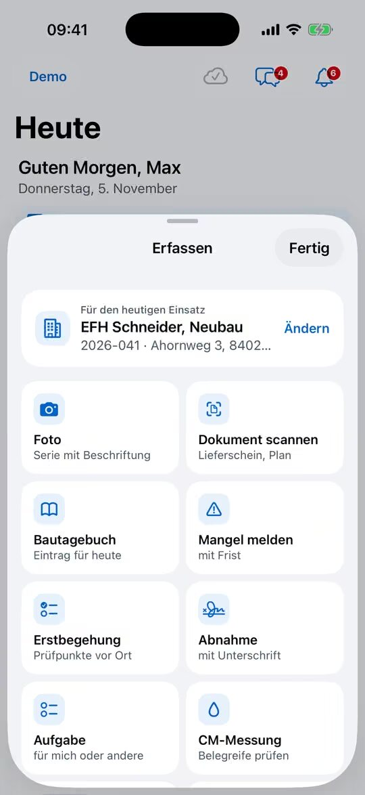

% datei: Kurzanleitung-02-Fotos-und-Dokumente-zur-Bauakte
% art: Kurzanleitung · App
% fuer: Kolonne und Bauleitung

# Fotos, Videos und Dokumente zur Bauakte

{rechts}

## Foto aufnehmen

1. Auf der **Heute**-Seite unter **Mein Einsatz** auf **Foto** tippen – das Foto landet direkt in der richtigen Bauakte.
   Andere Baustelle: Tab **Erfassen** → **Ändern** → Baustelle wählen → **Foto**.
2. Optional eine **Beschriftung** eingeben, z. B. „Randdämmung Bad OG“. Sie gilt für die ganze Serie.
3. Beliebig viele Fotos nacheinander aufnehmen (oder **Aus Fotos auswählen**).
4. **Übernehmen** tippen.

## Dokument scannen (Lieferschein, Plan)

1. In der Bauakte auf **Scanner** tippen (oder **Erfassen** → **Dokument scannen**).
2. Seiten scannen – der Scanner erkennt die Ränder selbst. Weitere Seiten mit **Weitere Seiten scannen**.
3. **Dokumentart** wählen (z. B. Lieferschein), **Text erkennen (durchsuchbares PDF)** anlassen.
4. **Als PDF ablegen** tippen.

## Video aufnehmen

1. Bauakte → **Mehr** → **Video aufnehmen** (oder **Erfassen** → **Video**).
2. Aufnehmen (höchstens **2 Minuten**) → **Video speichern**.

> **Tipp:** Kein Netz? Kein Problem: „Foto gespeichert – wird übertragen, sobald Netz da ist.“ Alles liegt
> verschlüsselt auf dem Gerät, bis es übertragen ist.

## Gut zu wissen

- Alles steht danach in der Bauakte unter **Fotos & Dokumente** – auch sofort im Büro.
- Foto groß ansehen: antippen. Dort **beschriften** oder **löschen** (ein übertragenes Foto wird auch im Büro gelöscht).
- Aus dem **Chat**: lange drücken → **In Bauakte übernehmen**. Im **Web**: **Hochladen** oder per Ziehen.
