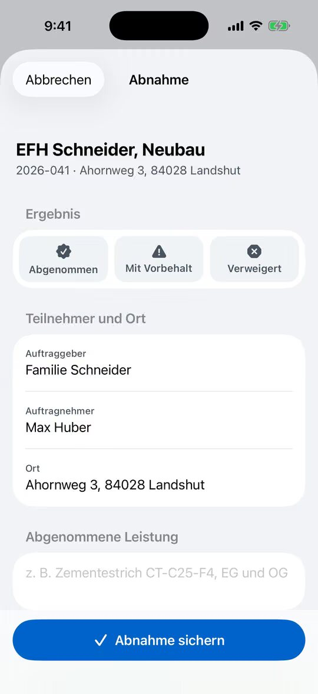
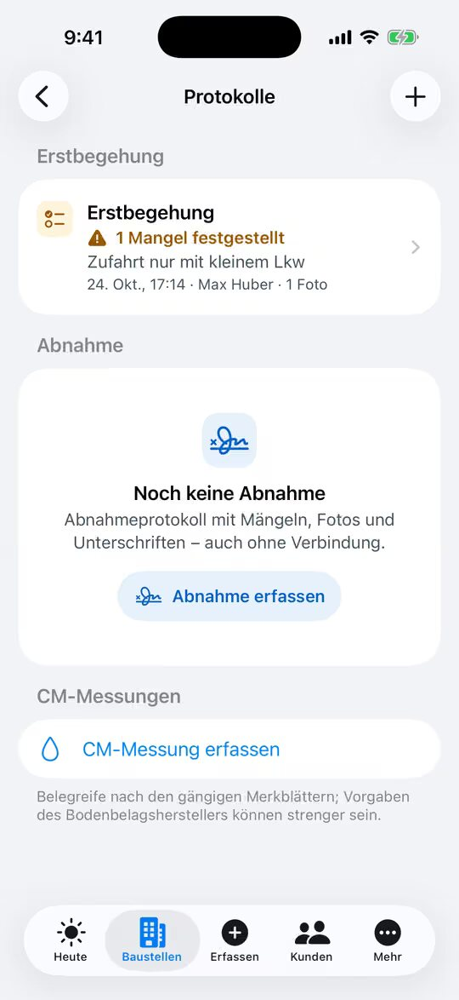

% datei: Kurzanleitung-04-Abnahme-mit-Unterschrift
% art: Kurzanleitung · App
% fuer: Bauleitung (und Kolonnenführer, wenn sie abnehmen)

# Abnahme mit Unterschrift

## In der App – auch ohne Netz

1. Bauakte öffnen → **Mehr** → **Abnahme** (oder **Erfassen** → **Abnahme**).
2. **Ergebnis** wählen: **Abgenommen**, **Mit Vorbehalt** oder **Verweigert**.
3. **Teilnehmer und Ort** prüfen (Auftraggeber, Auftragnehmer, Adresse) und die **abgenommene Leistung** eintragen,
   z. B. „Zementestrich CT-C25-F4, 65 mm, EG und OG“.
4. Bei Vorbehalt: **Mangel hinzufügen** – jeder Mangel wird als **Aufgabe mit Frist** in der Bauakte angelegt.
5. Fotos aufnehmen, **Notizen** ergänzen (Absprachen, Restarbeiten).
6. Unter **Unterschriften** unterschreiben **Auftraggeber** und **Auftragnehmer** mit dem Finger.
7. **Abnahme sichern** tippen.

## Kunde nicht vor Ort?

1. Abnahme ohne Unterschrift des Auftraggebers sichern und übertragen lassen (Verbindung nötig).
2. In der Bauakte unter **Protokolle** die Abnahme öffnen → **Freigabelink erstellen** (ist eine E-Mail des Kunden
   hinterlegt: **Freigabelink per E-Mail senden**). Der Link ist befristet.
3. Der Kunde öffnet den Link **ohne Anmeldung** und gibt frei oder lehnt mit Begründung ab. Die Bauakte zeigt danach
   „Online freigegeben von …“.

> **Hinweis:** Das fertige Protokoll erstellt der Server als PDF (**Protokoll (PDF) ansehen**, Verbindung nötig). Im
> Web legt EstrichONE es unter der Dokumentart **Abnahmen** ab. Je nach Einstellung wechselt die Bauakte danach auf
> **Abgeschlossen**.

## Im Web

Bauakte → **Dokumentation** → **Abnahmen** → **Abnahmeprotokoll erstellen** (oder **Aktionen** →
**Abnahmeprotokoll erstellen …**). Schritte: Termin, Leistung, Ergebnis, Fotos und Notizen, Unterschriften (Finger,
Stift oder Maus), **Abnahme speichern**. Für die Freigabe per Link: Häkchen **Auftraggeber nicht vor Ort: Freigabe per
Link an den Kunden**.
