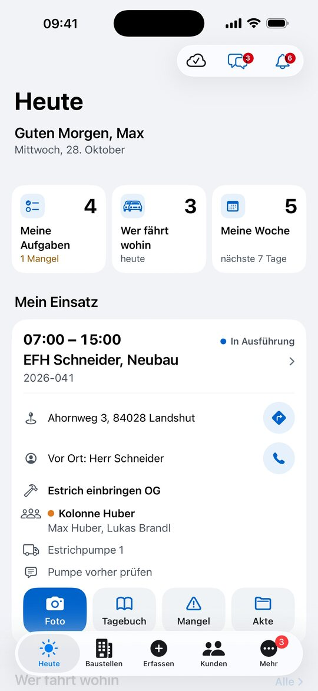
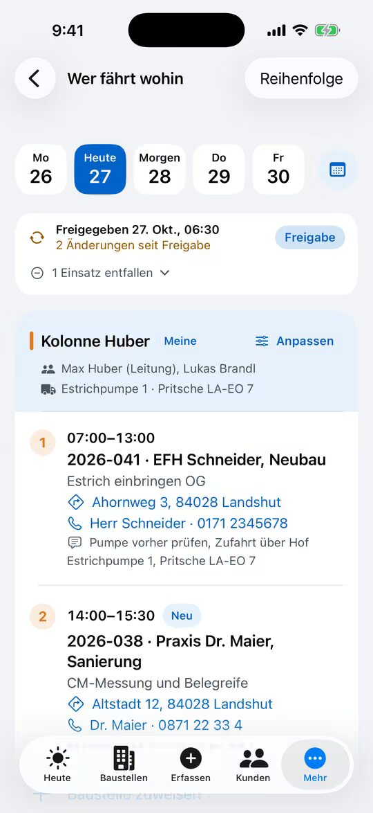
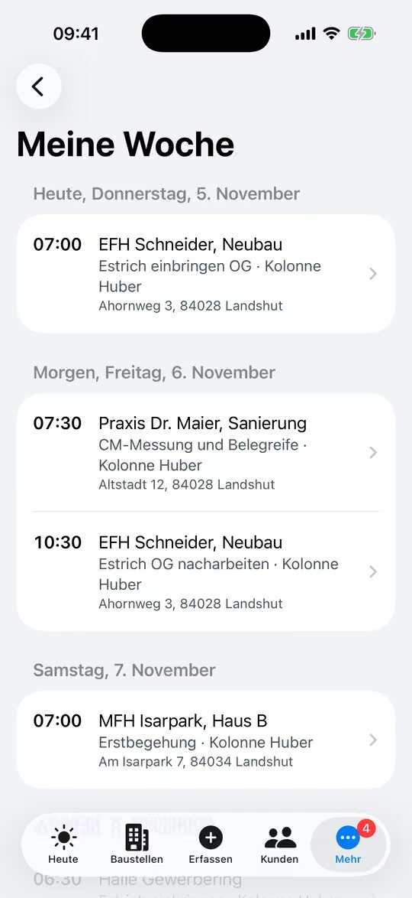

% datei: Kurzanleitung-05-Wer-faehrt-wohin-und-Meine-Woche
% art: Kurzanleitung · App
% fuer: Kolonne, Bauleitung und Disposition

# Wer fährt wohin und Meine Woche

## Morgens: Mein Einsatz

1. App öffnen – die **Heute**-Seite zeigt **Mein Einsatz**: Uhrzeit, Bauvorhaben, Adresse, Ansprechpartner, Tätigkeit,
   Kolonne, Fahrzeuge und Geräte.
2. **Route starten** öffnet Apple Karten mit der Baustelle als Ziel.
3. **Anrufen** wählt den Ansprechpartner vor Ort.
4. Darunter: **Foto**, **Tagebuch**, **Mangel**, **Akte** – immer für diese Baustelle.

## Wer fährt wohin

1. Kachel **Wer fährt wohin** antippen (oder **Mehr** → **Wer fährt wohin**).
2. Oben in der **Tagesleiste** den Tag wählen. Ihre Kolonne ist als **Meine** gekennzeichnet.
3. Jede Kolonne zeigt Besetzung, Fahrzeuge und die Baustellen **in Fahrtreihenfolge**. Tipp auf die Adresse = Route,
   Tipp auf den Einsatz = Bauakte.

## Meine Woche

Kachel **Meine Woche** antippen: alle Einsätze der nächsten Tage, nach Tagen gruppiert. **Morgen** steht zusätzlich
unten auf der Heute-Seite.

> **Wichtig:** Solange das Büro einen Tag nicht freigegeben hat, ist er **vorläufig**. Nach der Freigabe kommt eine
> Benachrichtigung; Änderungen danach sind mit **Neu** bzw. **Geändert** markiert.

**Mit Planungsrecht** (Disposition, Bauleitung): bei einer Kolonne **Anpassen** → **Baustelle zuweisen**,
**Mitarbeiter tauschen**, **Fahrzeug tauschen** oder **Kolonnen tauschen**; oben **Freigabe** gibt den Tag frei.
