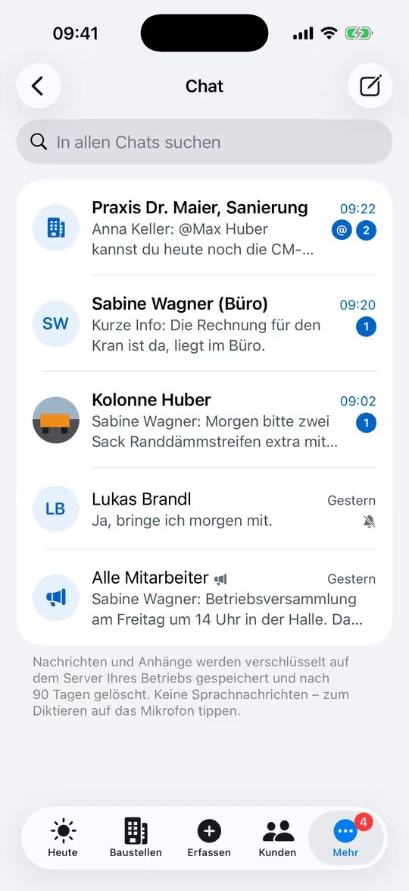
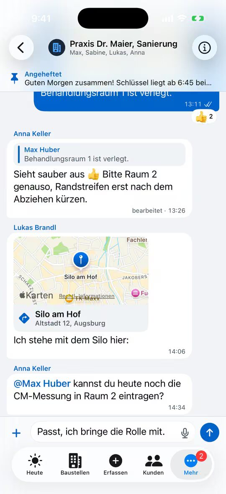

% datei: Kurzanleitung-06-Chat-Kolonne-und-Baustelle
% art: Kurzanleitung · App
% fuer: alle Mitarbeiter (wenn der Chat im Betrieb eingeschaltet ist)

# Chat: Kolonne und Baustelle

## Welche Chats gibt es?

- **Kolonnengruppe** – automatisch alle, die in der Planung zur Kolonne gehören.
- **Baustellengruppe** – automatisch Team und Bauleitung der Bauakte.
- **Einzelchat**, **Gruppe** und **Ankündigung** (z. B. „Alle Mitarbeiter“: alle lesen, nur Admins schreiben).

## Nachricht schreiben

1. Auf der Heute-Seite die **Sprechblase** oben rechts tippen (oder **Mehr** → **Chat**).
2. Unterhaltung wählen – neu: **Stift** oben rechts → **Neuer Chat** oder **Neue Gruppe**.
3. Text eingeben oder auf das **Mikrofon** tippen und diktieren. Mit `@Name` jemanden gezielt erwähnen.
4. **„+“** hängt **Kamera**, **Fotos**, **Dokument** (bis 25 MB) oder **Standort** an (auch die Baustellenadresse).
5. Auf den **Pfeil** tippen – gesendet.

## Nützliche Handgriffe

- **Lange drücken** auf eine Nachricht: **Antworten**, Reaktion, **Weiterleiten**, **Anheften**, **Bearbeiten** und
  bei Fotos/Dokumenten **In Bauakte übernehmen**.
- Aus der **Mitteilung** antworten: Mitteilung gedrückt halten → **Antworten**.
- Zu viele Mitteilungen? Namen oben antippen → **Stummschalten** (@Erwähnungen kommen trotzdem an).

> **Hinweis:** Der Chat liegt verschlüsselt auf dem Server des Betriebs – nicht bei einem Messenger-Anbieter. Keine
> privaten Gesundheitsdaten teilen. Ohne Netz wartet die Nachricht und wird automatisch gesendet.

**Im Web:** In der Bauakte **Baustellen-Chat anlegen** – eine Gruppe mit allen Beteiligten der Baustelle.
