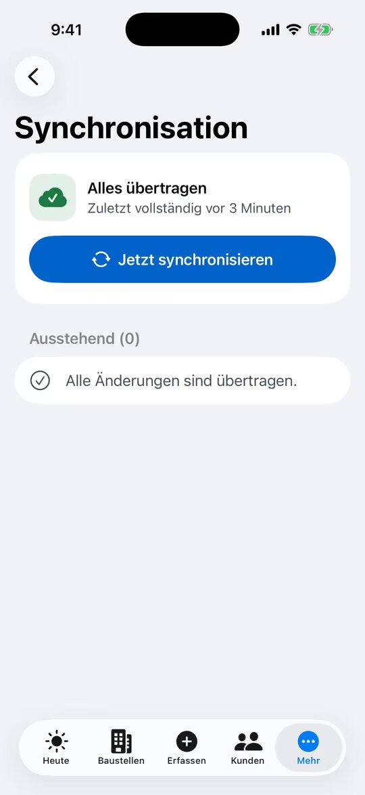
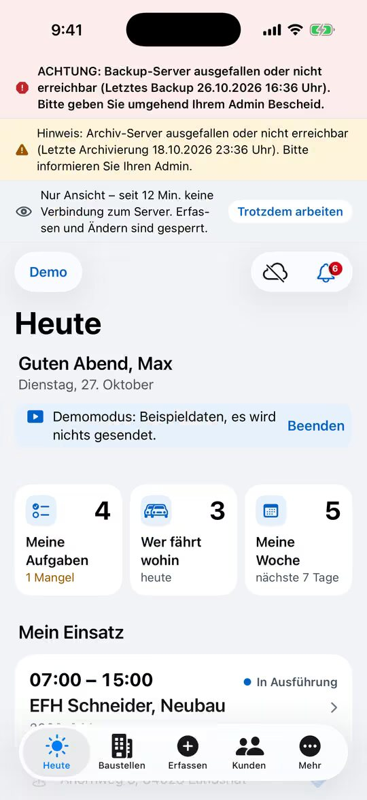

% datei: Kurzanleitung-07-Offline-und-Nur-Ansicht
% art: Kurzanleitung · App
% fuer: alle, die mit iPhone oder iPad arbeiten

# Offline arbeiten und „Nur Ansicht“

## Kein Netz auf der Baustelle

Arbeiten Sie einfach weiter: Fotos, Dokumente, Bautagebuch, Mängel, Erstbegehung, CM-Messung, Abnahme, neue Bauakten
und Chatnachrichten werden **verschlüsselt auf dem Gerät** gespeichert und übertragen, sobald Netz da ist.

1. Netz wieder da? App **öffnen** – sie gleicht von selbst ab.
2. Prüfen: **Mehr** → **Synchronisation**. Oben „Alles übertragen“, darunter **Ausstehend**.
3. Hängt etwas: **Jetzt synchronisieren** oder **Fehlgeschlagene Uploads erneut versuchen**.
4. **Bitte prüfen / Vom Server abgelehnt**: Grund lesen, Bauakte prüfen, Eintrag nach links wischen.

> **Wichtig:** Solange **Ausstehend** nicht leer ist, liegen Daten **nur auf diesem Gerät**. Nicht abmelden, App nicht
> löschen, Gerät nicht zurücksetzen.

## Graue Leiste „Nur Ansicht“

Ist der Server **länger als 5 Minuten** nicht erreichbar, schaltet die App auf **Nur Ansicht**: Ansehen geht, Erfassen
ist gesperrt – damit wichtige Daten nicht lange nur auf einem Gerät liegen.

1. Netz prüfen (WLAN, Mobilfunk) und kurz warten.
2. Müssen Sie trotzdem erfassen: in der Leiste **Trotzdem arbeiten** → **Auf eigene Gefahr offline arbeiten**.
3. Ist der Server wieder da, endet der Modus von selbst und alles wird übertragen.

## Andere Leisten und Bildschirme

| Anzeige | Was tun? |
|---|---|
| **Rote Leiste** – Backup-Server ausgefallen | **Umgehend** die Administration informieren. Weiterarbeiten geht. |
| **Gelbe Leiste** – Archiv-Server ausgefallen | Administration informieren. Weiterarbeiten geht. |
| **Wartungsarbeiten** | Abwarten – die App gibt sich danach **selbst** frei. |

Nur **mit Verbindung**: PDFs (Bauakte, Protokolle), Änderungsverlauf, Konfliktprüfung und Freigabe der Planung,
Freigabelinks für die Abnahme.
