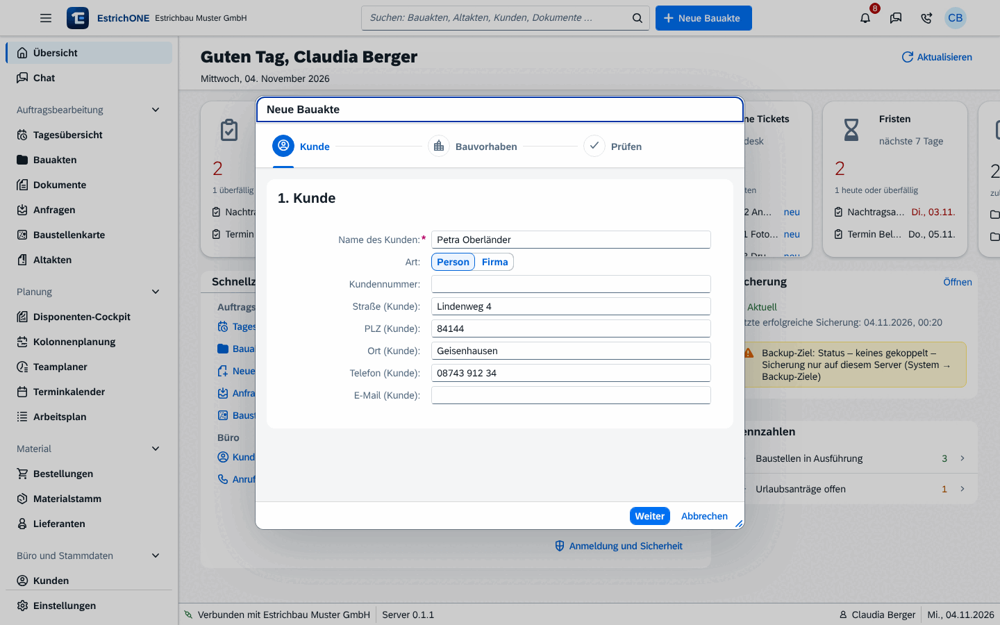

% datei: Kurzanleitung-08-Web-Bauakte-anlegen
% art: Kurzanleitung · Web
% fuer: Büro und Bauleitung

# Web: Neue Bauakte anlegen

{mittel}

## So geht's

1. Oben auf **Neue Bauakte** klicken – oder <kbd>Alt</kbd> + <kbd>N</kbd>.
2. **Kunde:** Namen eintippen. Vorhandene Kunden werden vorgeschlagen – anklicken übernimmt alle Angaben. Neuer Kunde:
   **Person** oder **Firma** wählen, Anschrift, Telefon und E-Mail ergänzen.
3. **Weiter** klicken. EstrichONE prüft auf **Dubletten** (Name, Telefon, E-Mail, Anschrift).
   Treffer? Vorhandenen Kunden wählen → **Diesen Kunden verwenden**. Nur wenn es wirklich ein anderer ist:
   **Trotzdem als neuen Kunden anlegen**.
4. **Bauvorhaben:** aussagekräftige Bezeichnung, z. B. „EFH Müller, Neubau“. Unter **Anlegen als** wählen:
   **Bauakte (Auftrag)** oder **Anfrage**. Optional eine **Vorlage** (legt Ordner, Räume und Kennwerte an).
5. Baustellenadresse eintragen – oder **Adresse des Kunden übernehmen**.
6. **Kennwerte** ergänzen, wenn angeboten (Objektart, Estrichart, Fläche, Dicke, Fußbodenheizung …).
7. **Prüfen** und **Anlegen** klicken. Die **Aktennummer** (z. B. 2026-001) vergibt EstrichONE automatisch.

> **Tipp:** Sie sind beim Kunden vor Ort? Häkchen **Direkt im Anschluss die Erstbegehung durchführen** setzen – das
> Protokoll öffnet sich gleich nach dem Anlegen.

## Danach in der Bauakte

- **Mir zuweisen** trägt Sie als Zuständige(n) ein; unter **Kontakte** → **Team im Betrieb** → **Mitarbeiter zuweisen**
  sehen auch Kolonnen mit dem Recht „Eigene Bauakten sehen“ die Akte in der App.
- **Status** ändern: Anfrage → Geplant → In Ausführung → Belegreif / Trocknung → Abgeschlossen.
- **Einsätze** → **Einsatz planen** oder **Zur Plantafel**.

**In der App:** Tab **Baustellen** → **„+“** – Assistent in vier Schritten, auch ohne Netz. Die Nummer vergibt der Server
beim nächsten Abgleich („Neu · noch ohne Nummer“).
