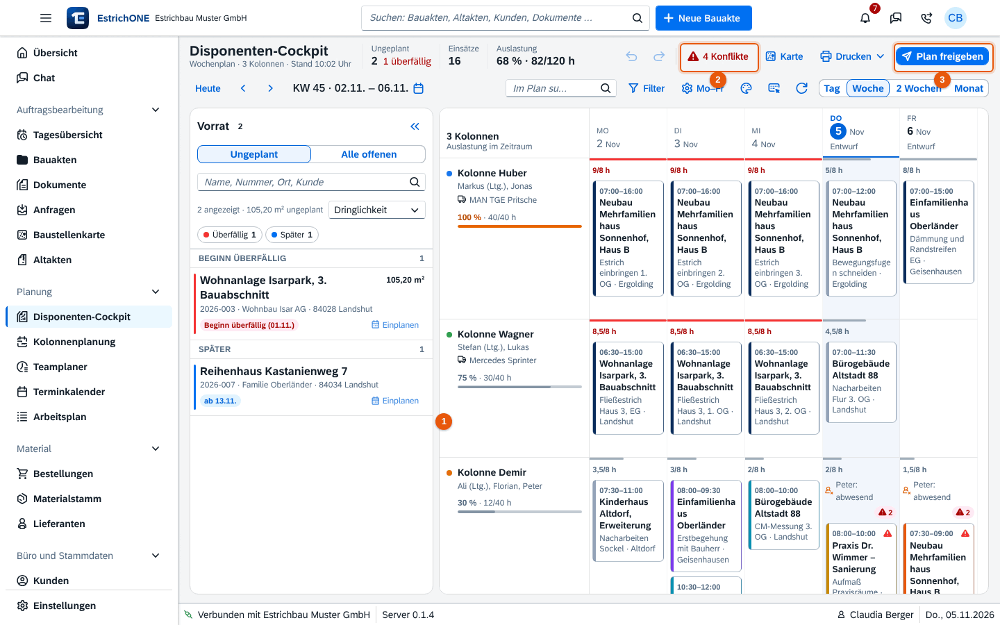

% datei: Kurzanleitung-09-Web-Cockpit-Disposition-und-Freigabe
% art: Kurzanleitung · Web
% fuer: Disposition und Bauleitung

# Web: Cockpit, Disposition und Freigabe

{mittel}

## Einplanen

1. **Planung** → **Disponenten-Cockpit** öffnen. Ansicht wählen: **Tag**, **Woche**, **2 Wochen** oder **Monat**.
2. Links im **Vorrat** stehen ungeplante Bauvorhaben. Karte auf **Kolonne und Tag ziehen** – oder **Einplanen** klicken.
3. Einsatz ändern: **Doppelklick** (bearbeiten), **ziehen** (verschieben), <kbd>Strg</kbd> + ziehen (kopieren),
   **Rechtsklick** (Tagesbesetzung, Kolonne tauschen, Reihenfolge …).
4. Versehen? <kbd>Strg</kbd> + <kbd>Z</kbd> nimmt zurück, <kbd>Strg</kbd> + <kbd>Y</kbd> stellt wieder her.

## Konflikte lösen

1. Schaltfläche **Konflikte** (mit Anzahl) öffnen – z. B. Person abwesend, Gerät doppelt, Kolonne überlastet.
2. Einsatz verschieben, Tagesbesetzung ändern oder Kolonnen tauschen.

Konflikte sind **Hinweise** – EstrichONE verhindert die Planung nicht.

## Plan freigeben

1. **Plan freigeben** klicken (nach Änderungen: **Änderungen freigeben (n)**).
2. **Zeitraum** wählen: sichtbarer Zeitraum ab heute, heute, morgen oder nächste Woche.
3. Optional **Hinweis** an die Kolonnen, z. B. „Treffpunkt 6:30 Uhr am Lager“.
4. **Änderungen seit der letzten Freigabe** prüfen und **Freigeben**.

> **Wichtig:** Nicht freigegebene Tage stehen als **Entwurf** im Plan und sind für Mitarbeiter nur vorläufig. Nach der
> Freigabe sehen die Kolonnen den Plan in der App unter **Wer fährt wohin** und werden benachrichtigt.

## Tastatur

<kbd>?</kbd> Hilfe · <kbd>T</kbd> heute · <kbd>W</kbd> Wochenende · <kbd>Bild ↑</kbd>/<kbd>Bild ↓</kbd> Zeitraum ·
<kbd>Alt</kbd> + <kbd>←</kbd>/<kbd>→</kbd> Auswahl ±1 Tag · <kbd>N</kbd> nächster freier Tag · <kbd>Entf</kbd> entfernen

**Drucken** gibt den Plan als PDF aus (Aushang im Lager); **Karte** zeigt die Baustellen des Zeitraums.
