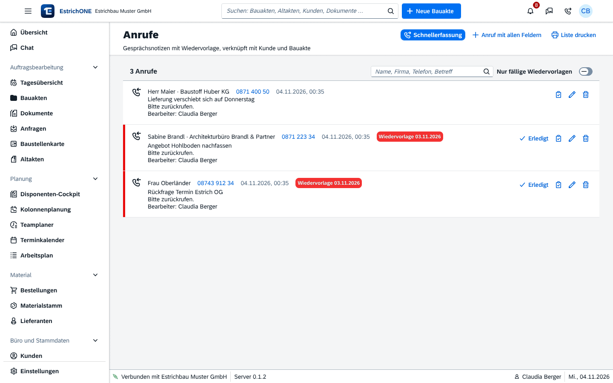

% datei: Kurzanleitung-10-Web-Kunden-Anrufe-Anfragen
% art: Kurzanleitung · Web
% fuer: Büro

# Web: Kunden, Anrufe und Anfragen

## Anruf während des Gesprächs erfassen

1. Oben in der Kopfzeile auf das **Telefon**-Symbol klicken – die Gesprächsdauer läuft mit.
2. **Wer ruft an?** – Name, Firma oder Nummer; bekannte Kunden werden vorgeschlagen.
3. **Rückrufnummer**, **Richtung** (Eingehend/Ausgehend) und **Notiz** eintragen.
4. Optional **Kunde zuordnen**, **Bauakte zuordnen**, **Wiedervorlage am**.
5. **Speichern** (<kbd>Strg</kbd> + <kbd>Enter</kbd>) – oder **Als Anfrage speichern**, wenn ein neues Bauvorhaben
   angefragt wird.

{mittel}

## Wiedervorlagen abarbeiten

1. Die Zahl am Telefon-Symbol zeigt die heute fälligen Wiedervorlagen.
2. **Büro und Stammdaten** → **Anrufe** → **Nur fällige Wiedervorlagen**.
3. Je Eintrag: **Erledigt**, **Als Aufgabe in die Bauakte**, **Bearbeiten**.

## Anfrage zur Bauakte machen

1. **Auftragsbearbeitung** → **Anfragen** – neue mit **Anfrage erfassen**.
2. Anfrage öffnen, Status setzen (**Offen** → **In Bearbeitung**).
3. Angaben mit einem Klick in eine **Bauakte** übernehmen (als Anfrage oder direkt als Auftrag).

## Kundenstamm

- **Büro und Stammdaten** → **Kunden**: Suche nach Name, Nummer, Ort, Telefon, E-Mail.
- **Neuer Kunde** (mit Dublettenprüfung), **CSV importieren**, **Serien-E-Mail** an markierte Kunden.
- Kundenakte: **Anrufen**, **E-Mail**, **Neue Bauakte** (Kunde vorbelegt), alle Bauakten und Dokumente des Kunden.

> **Tipp:** Telefonnummern vollständig pflegen – dann erkennt die Dublettenprüfung bekannte Anrufer auch bei anderer
> Schreibweise des Namens.
