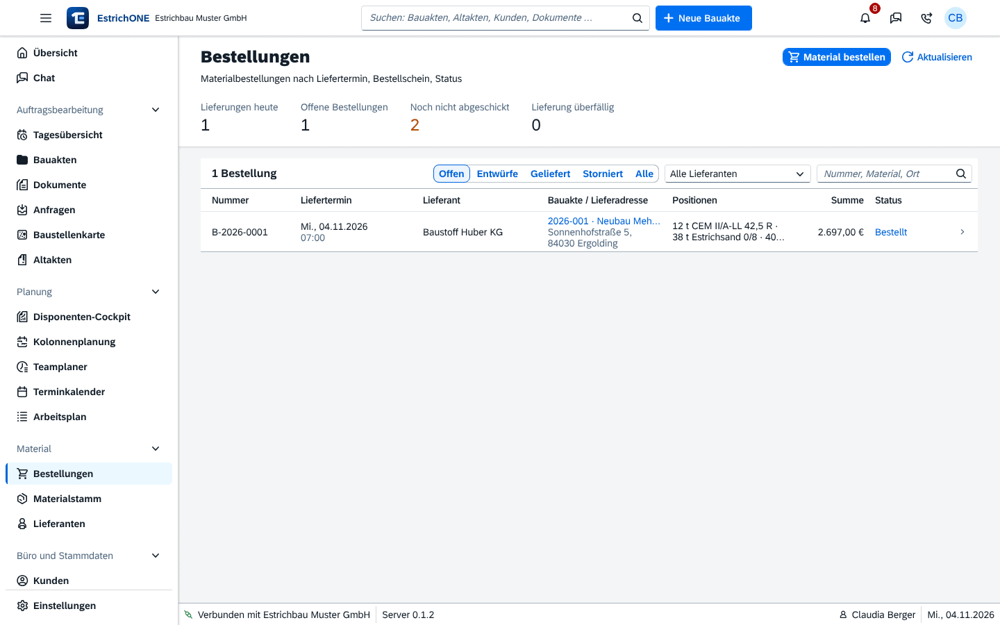

% datei: Kurzanleitung-12-Material-und-Bestellungen
% art: Kurzanleitung · Web
% fuer: Büro, Disposition und Bauleitung

# Material und Bestellungen

{mittel}

## Bedarf aus der Bauakte

1. Bauakte → **Material**: EstrichONE berechnet aus **Räume & Flächen** den Bedarf (Volumen = Fläche × Dicke,
   aufgerundet auf 0,5 m³; Dämmung auf volle m²). **Reserve** in Prozent einstellen.
2. Positionen markieren → **Auswahl bestellen**.

## Bestellung anlegen

1. **Material** → **Bestellungen** → **Material bestellen** (aus der Bauakte sind Bauakte und Positionen vorbelegt).
2. **Lieferant** wählen, optional die **Bauakte** (ohne Bauakte: Lager).
3. **Liefertermin** und **Zeitfenster** (oder „nach Absprache“).
4. **Lieferadresse** und **Ansprechpartner vor Ort** – leer = Baustelle bzw. Ansprechpartner der Bauakte.
5. **Positionen**: Artikel, Menge, Einheit, Einzelpreis – weitere mit **Position hinzufügen**.
6. **Hinweise an den Lieferanten**, z. B. „Anfahrt nur über Hofeinfahrt“.
7. **Speichern** – die Bestellung ist ein **Entwurf**.
8. Bestellschein per **E-Mail** senden oder **Drucken / PDF**. Ohne erneuten Versand: **Nur als bestellt markieren**.

## Status verfolgen

**Entwurf** → **Bestellt** → **Bestätigt** → **Geliefert** (oder **Storniert**). Oben: **Lieferungen heute**,
**Offene Bestellungen**, **Noch nicht abgeschickt**, **Lieferung überfällig**. Anstehende Lieferungen stehen auch im
Kopf der Bauakte.

> **Hinweis:** Das Modul **Material** schaltet die Administration unter **Systemeinstellungen** → **Module** ein oder
> aus. Artikel pflegen Sie unter **Material** → **Materialstamm**, Lieferanten unter **Material** → **Lieferanten**.
