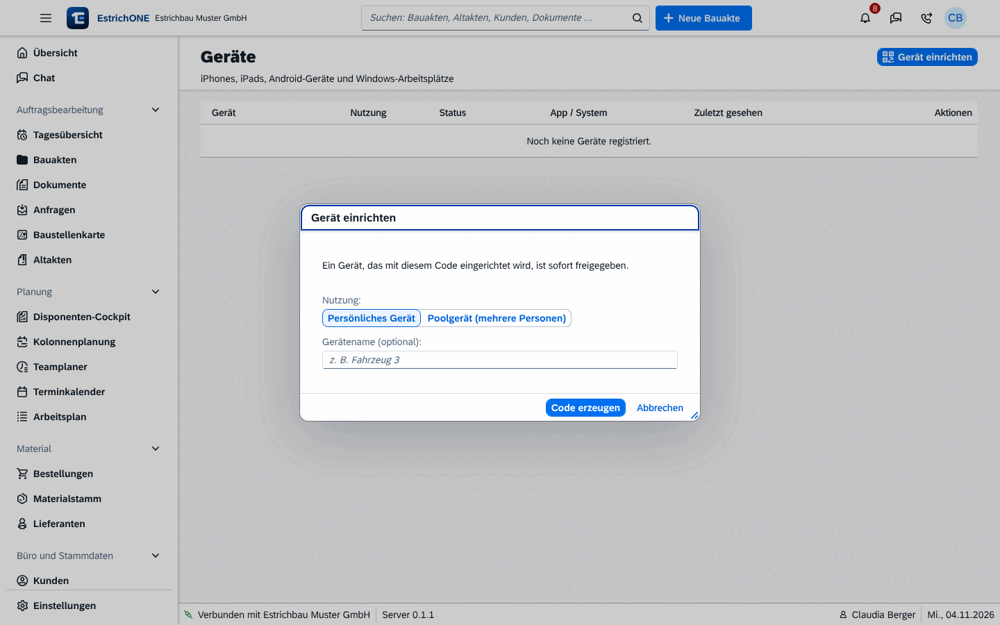
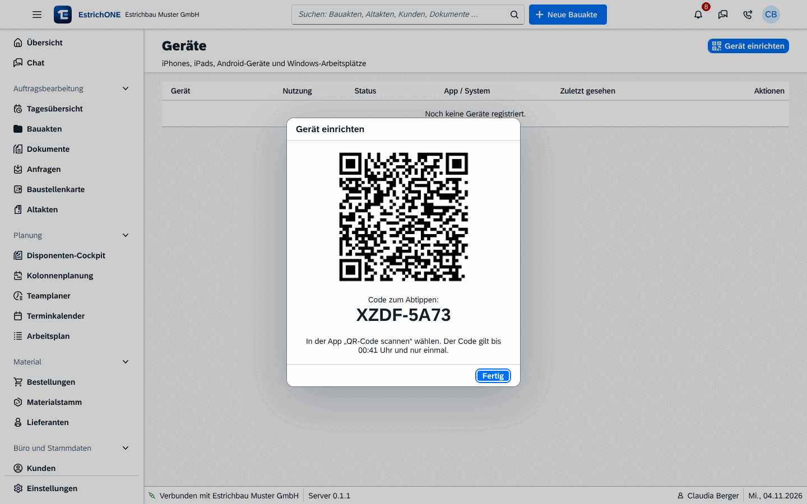

% datei: Kurzanleitung-13-Admin-Benutzer-und-Geraete-anlegen
% art: Kurzanleitung · Administration
% fuer: Administration und IT

# Admin: Benutzer und Geräte anlegen

## Benutzer anlegen

1. **Benutzer & Geräte** → **Benutzer** → **Benutzer anlegen**.
2. **Name**, **Anmeldename** (z. B. „m.huber“), optional **E-Mail** und **Telefon**.
3. Eine oder mehrere **Rollen** wählen: **Administrator**, **Büro und Bauleitung**, **Baustelle**, **IT-Administration**
   oder eigene Rollen.
4. **Anlegen**. Das **Einmalpasswort** erscheint: **Kopieren** oder **Zugangsbrief (PDF)** ausdrucken. Mit
   eingerichtetem E-Mail-Konto geht der Zugangsbrief auch per E-Mail.
5. Bei der ersten Anmeldung legt der Benutzer ein eigenes Passwort fest (mindestens 12 Zeichen).

> **Tipp:** Neue Mitarbeiter am besten unter **Personal (HR)** → **Mitarbeiter** → **Mitarbeiter anlegen** – mit
> Benutzerkonto und **Onboarding-PDF** (Zugangsdaten, App-Einrichtung per QR-Code, erste Schritte).

{web}
{web}

## Gerät einrichten (QR-Code)

1. **Benutzer & Geräte** → **Geräte** → **Gerät einrichten**.
2. **Nutzung** wählen: **Persönliches Gerät** oder **Poolgerät (mehrere Personen)**.
3. Optional **Gerätenamen** eintragen (z. B. „iPad Kolonne Huber“) → **Code erzeugen**.
4. In der App **QR-Code scannen** – oder den **Code zum Abtippen** eingeben. Der Code gilt kurz und nur einmal.

Mit Code eingerichtete Geräte sind sofort freigegeben; selbst angemeldete Geräte geben Sie mit **Freigeben** frei.

## Wenn etwas passiert

| Fall | Aktion |
|---|---|
| Passwort vergessen | **Benutzer** → **Passwort zurücksetzen** (neues Einmalpasswort mit Zugangsbrief) |
| Handy mit Authenticator verloren | **Zwei-Faktor-Anmeldung zurücksetzen (Handy verloren)** |
| Mitarbeiter scheidet aus | **Sperren** – Benutzer werden nicht gelöscht, Verlauf bleibt nachvollziehbar |
| Gerät verloren oder gestohlen | **Geräte** → **Sperren**, danach Passwörter der Nutzer ändern |
| Gerät neu verbinden | **Neu einrichten** (neuer Code für dasselbe Gerät) |

Rechte anpassen: **Benutzer & Geräte** → **Rollen und Rechte** (Häkchen setzen → **Änderungen speichern**).
