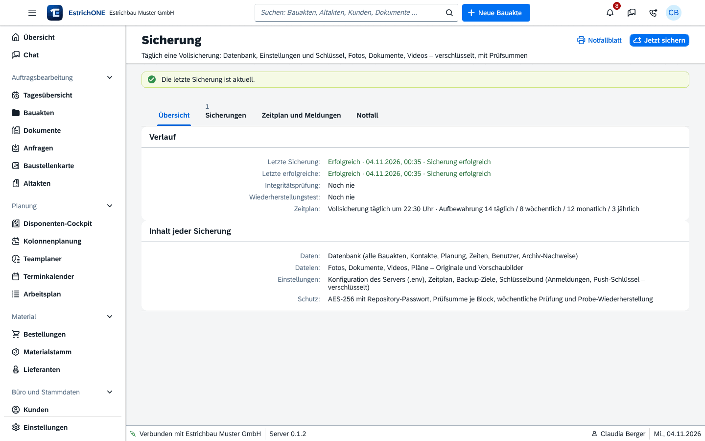

% datei: Kurzanleitung-14-Admin-Backup-Center-und-Notfallblatt
% art: Kurzanleitung · Administration
% fuer: Administration

# Admin: Backup Center und Notfallblatt

{mittel}

## Täglich prüfen (1 Minute)

1. **Datensicherung & Archiv** → **Sicherung** öffnen (oder Card **Sicherung** auf der Startseite).
2. **Letzte erfolgreiche Sicherung**, **Integritätsprüfung** und **Wiederherstellungstest** prüfen.
3. Vor größeren Änderungen: **Jetzt sichern**.

> **Achtung:** Eine **rote Leiste** „Backup-Server ausgefallen“ sehen alle Benutzer in Web und App. Sofort kümmern!

## Notfallblatt – einmalig, jetzt

1. Reiter **Notfall** → **Notfallblatt (PDF)** öffnen und **ausdrucken**.
2. Getrennt vom Server aufbewahren (Tresor). Es enthält den **Wiederherstellungsschlüssel** – ohne ihn sind die
   Sicherungen wertlos.

## Einzelne Datei zurückholen

1. Reiter **Sicherungen** → Stand wählen.
2. **Dokumentsymbol** → Foto oder Dokument zurückholen. Der Rest bleibt unverändert.

## Ganzes System wiederherstellen

1. Reiter **Sicherungen** → Stand → **Wiederherstellen**, zur Sicherheit `WIEDERHERSTELLEN` eintippen.
2. Während der Wiederherstellung ist EstrichONE gesperrt (Wartungsmodus). Danach melden sich alle neu an.

Änderungen nach dem Stand gehen verloren; die Apps behalten ungesendete Eingaben und gleichen danach ab.

## Totalausfall des Servers

1. Neuen Linux-Server mit Docker bereitstellen, Domain auf ihn zeigen lassen.
2. Befehl aus dem Reiter **Notfall** ausführen (**Befehl kopieren**).
3. Quelle (Ordner oder Zugang vom Notfallblatt) und **Wiederherstellungsschlüssel** eingeben.

**Zeitplan:** Reiter **Zeitplan und Meldungen** – tägliche Vollsicherung (Standard 22:30 Uhr), optional inkrementell,
wöchentliche Probe-Wiederherstellung, Aufbewahrung, Pushnachrichten an Administratoren.
