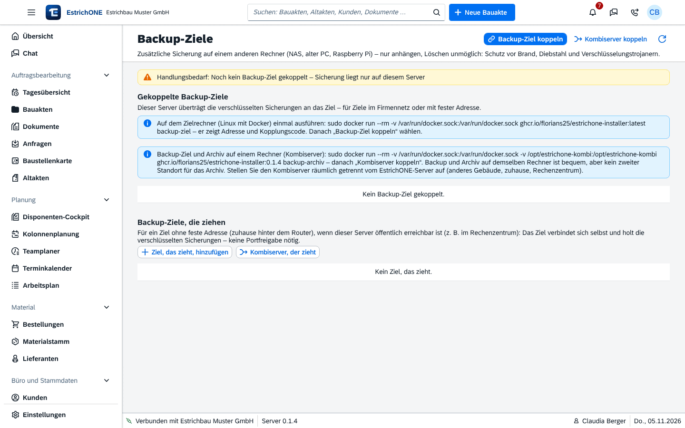

% datei: Kurzanleitung-15-Admin-Kombiserver-Backup-Ziel-und-Archiv-koppeln
% art: Kurzanleitung · Administration
% fuer: Administration und IT

# Admin: Kombiserver koppeln (Backup-Ziel und Archiv)

Ein zweiter Rechner (NAS, alter PC, Raspberry Pi mit Linux und Docker) – **räumlich getrennt** vom EstrichONE-Server –
nimmt die Sicherungen „nur anhängen“ auf und archiviert Dokumente revisionssicher.

## Kombiserver einrichten

1. Auf dem Kombiserver einmal ausführen:

`sudo docker run --rm -v /var/run/docker.sock:/var/run/docker.sock -v /opt/estrichone-kombi:/opt/estrichone-kombi ghcr.io/florians25/estrichone-installer:latest backup-archiv`

2. Notieren: **Adresse**, Ports (Backup-Ziel 8444, Archiv 8443), **Kopplungscode** und beide **Fingerabdrücke**.
3. In EstrichONE: **Datensicherung & Archiv** → **Backup-Ziele** → **Kombiserver koppeln**.
4. Adresse und Kopplungscode eingeben. Beide Dienste werden gekoppelt.
5. **Fingerabdrücke vergleichen**.
6. **Notfallzugang** herunterladen und mit dem Backup-Passwort getrennt vom Server aufbewahren.

{mittel}

## Sonderfälle

- **Kombiserver zuhause, EstrichONE im Rechenzentrum:** **Kombiserver, der zieht** – das Backup-Ziel holt die
  Sicherungen selbst (keine Portfreigabe); das Archiv koppeln Sie danach über eine weitergeleitete Adresse (Port 8443)
  oder eine Tunnel-Adresse mit demselben Code.
- **Nur Backup-Ziel:** Installer-Modus `backup-ziel`, dann **Backup-Ziel koppeln**.
- **Nur Archivserver:** Installer-Modus `archiv`, dann **Datensicherung & Archiv** → **Archiv** → **Archivserver koppeln**.

## Danach

1. **Archiv** → **Aufbewahrung je Dokumentart** festlegen und **Regeln speichern** (Fristen mit der Steuerberatung klären).
2. In den Archiv-Einstellungen **Automatisch archivieren** und **Akten auslagern nach** (Monate; 0 = nur manuell).
3. **Archiv prüfen** testet die Unversehrtheit.

> **Wichtig:** Backup und Archiv auf einem Rechner ist **kein zweiter Standort** für das Archiv. Rote Leiste =
> Backup gestört, gelbe Leiste = Archiv gestört.
