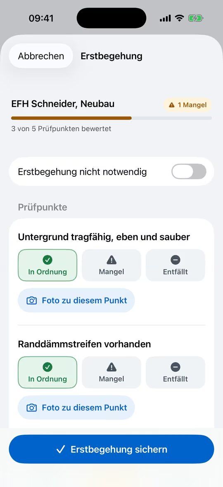
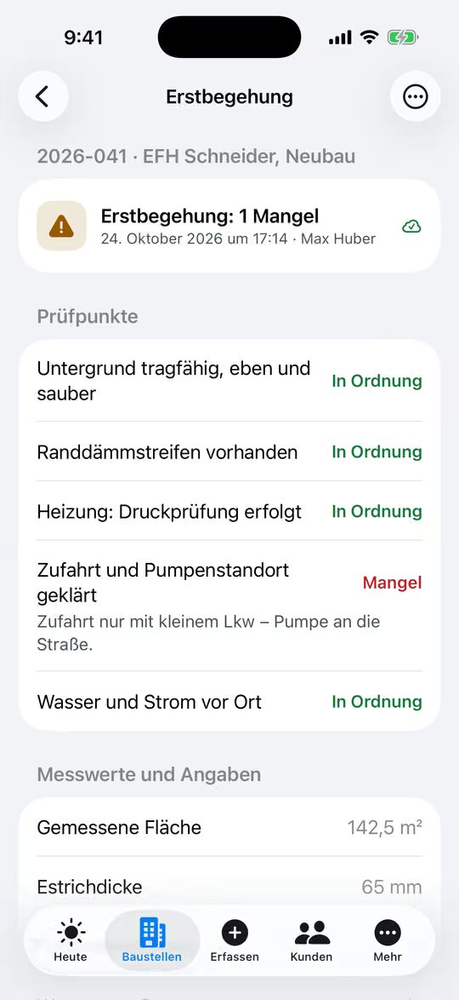

% datei: Kurzanleitung-17-Erstbegehung-und-CM-Messung
% art: Kurzanleitung · App
% fuer: Bauleitung

# Erstbegehung und CM-Messung

## Erstbegehung

1. Bauakte → **Mehr** → **Erstbegehung** (oder **Protokolle** bzw. **Erfassen** → **Erstbegehung**).
2. Je Prüfpunkt **In Ordnung**, **Mangel** oder **Entfällt** – mit **Foto zu diesem Punkt**, bei Mangel kurz beschreiben.
3. **Messwerte und Angaben** (z. B. Fläche, Estrichdicke) und **Notizen** eintragen.
4. Unter **Fotos und Unterschrift** weitere Fotos aufnehmen, Kunde **unterschreiben** lassen.
5. **Erstbegehung sichern** tippen.

Nicht nötig? **Erstbegehung nicht notwendig** einschalten und **Begründung** angeben. Eine erfasste Erstbegehung wird
nicht überschrieben, sondern **korrigiert**. PDF: **Als PDF ansehen** (Verbindung nötig).

## CM-Messung (Belegreife)

1. Bauakte → **Mehr** → **CM-Messung** (oder **Protokolle** bzw. **Erfassen**).
2. **Estrichart** wählen – **Zementestrich (CT)** oder **Calciumsulfatestrich (CA)** – und ob **beheizt**.
3. **Messort** (z. B. „Bad OG“) und **Messwert** in CM-% eintragen, optional Foto vom Messgerät.
4. Die App zeigt sofort **Belegreif** oder **Noch nicht belegreif**.

| Estrichart | unbeheizt | beheizt |
|---|---|---|
| Zementestrich (CT) | 2,0 CM-% | 1,8 CM-% |
| Calciumsulfatestrich (CA) | 0,5 CM-% | 0,3 CM-% |

> **Hinweis:** Maßgeblich ist die Bewertung des Servers; Vorgaben des Belagsherstellers können strenger sein. Die
> Prüfpunkte der Erstbegehung legt die Administration im Web fest (**Stammdaten** → **Formulare** → **Erstbegehung**).
