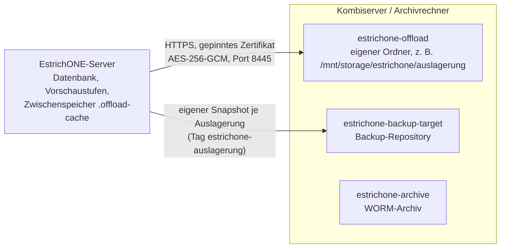

# Speicherschonende Ablage von Fotos und Dokumenten

Gilt für jeden Upload – Web, iPhone/iPad, Android, Windows –, weil der Server verdichtet. Einstellungen unter
**Systemeinstellungen → Speicher** (`settings.media`, für alle lesbar, damit Apps passend vorverkleinern können).

## Fotos
- JPEG-Fotos werden mit **mozjpeg-Einstellungen** neu kodiert (libvips: Trellis-Quantisierung, optimierte
  Huffman-Tabellen, progressive Scans, Quantisierungstabelle 3), Qualität **82** (einstellbar 60–95).
- **EXIF-Ausrichtung** wird angewendet (Bild steht danach richtig, Ausrichtung = 1). **Aufnahmezeit, GPS, XMP und
  Farbprofil bleiben erhalten.**
- Längste Kante höchstens **4096 px** (einstellbar 2048–8192, Lanczos). Das reicht für A4-Druck mit 300 dpi.
- Gespeichert wird nur, wenn das Ergebnis mindestens 8 % kleiner ist (oder gedreht/verkleinert werden musste);
  sonst bleibt das Original bitgenau. „Fotos unverändert speichern“ schaltet die Verdichtung ab.
- PNG, WebP, HEIC und Videos bleiben unverändert (Videos: keine Transkodierung, da im API-Image kein ffmpeg).
- Vorschaustufen (WebP, ohne Metadaten): `thumb` 320 px, `display` 1280 px, `large` 2560 px
  (`GET /api/v1/files/{id}/content?variant=…`).

Messung mit echten Kamerafotos (Server, Standardeinstellungen):

| Foto | vorher | nachher | Ersparnis | PSNR |
|---|---:|---:|---:|---:|
| iPhone 6, 3264×2448 | 2,59 MB | 0,93 MB | 64 % | 38,7 dB |
| iPhone 5, 3264×2448 (um 180° gedreht gespeichert) | 2,37 MB | 0,72 MB | 69 % | 40,3 dB |
| Nikon, 3888×2592 (bereits stark komprimiert) | 0,74 MB | 0,63 MB | 14 % | 46,3 dB |
| 6000×4500, Qualität 95 | 5,44 MB | 1,20 MB (4096×3072) | 78 % | – |

Zum Vergleich: ImageMagick mit Qualität 82 ohne mozjpeg ergibt beim iPhone-6-Foto 1,19 MB. Ab etwa 38 dB PSNR ist
ein Unterschied in der 100-%-Ansicht praktisch nicht sichtbar.

## Dokumente
- **PDFs** werden verlustfrei neu geschrieben: unkomprimierte Streams mit Flate gepackt, nur erreichbare Objekte
  gespeichert. Ergebnis zählt nur, wenn es mindestens 8 % kleiner ist und sich mit gleicher Seitenzahl öffnen lässt.
  **Signierte** (`/ByteRange`, `/Sig`), verschlüsselte und XFA-PDFs bleiben bitgenau.
- Office-Dateien und alles andere bleiben unverändert.

## Dubletten
Gleiche Prüfsumme und Größe → die neue Datei benutzt die vorhandene Ablage mit (auch über Bauakten hinweg). Die
Archivierung löscht ein Original nur, wenn keine andere Datei es mitbenutzt.

## Prüfsummen
`sha256`/`sizeBytes` einer Datei beschreiben nach dem Upload den **gespeicherten** Inhalt. Die beim Ankündigen
übermittelte Prüfsumme bleibt gültig: Eine wiederholte Ankündigung mit dem Original gilt weiterhin als dieselbe Datei.

## Nachverdichten und Statistik
`GET /api/v1/files/storage` (Belegung je Art, Ersparnis, Dubletten, Datenträger, Kandidaten, Status) und
`POST /api/v1/files/storage/optimize` (Hintergrundlauf) – beides mit `settings.manage`. Archivierte oder zur
Archivierung vorgemerkte Dateien werden nie verändert (ihre Prüfsumme liegt im Archiv).

## Auslagerung auf den Storage (Speicherstufe „Storage“)

Wird der Platz auf dem EstrichONE-Server knapp, wandern **Datei-Originale** (Fotos, Videos, Dokumente) verschlüsselt auf
einen gekoppelten **Storage** – den Kombiserver oder einen Archivrechner. Verwaltung: **System → Speicher-Auslagerung**
(`/system/auslagerung`, Recht `settings.manage`). Die Vorschaustufen (`thumb`, `display`, `large`) bleiben lokal: Listen,
Raster, Berichte und Abnahmen funktionieren unverändert, und ausgelagerte Dateien bleiben in Web und Apps sichtbar.



### Storage einrichten

Der Storage ist ein **eigener Dienst mit eigenem Datenbereich** (Container `estrichone-offload`, Image `estrichone-archive`
in der Rolle `offload`, Port 8445) – getrennt vom WORM-Archiv und vom Backup-Repository, mit eigenem Zertifikat, eigener
Kopplung und eigenem Updater (Fernaktualisierung wie bei den anderen Zusatzservern).

**Bestehenden Kombiserver erweitern** (z. B. einer mit Version 0.1.3 und den Daten unter `/mnt/storage/estrichone/backup`
und `/mnt/storage/estrichone/archiv`): auf dem Kombiserver **denselben Befehl wie bei der Einrichtung** mit der neuen
Version und zusätzlich dem Ordner für die Auslagerung ausführen:

```bash
sudo docker run --rm -v /var/run/docker.sock:/var/run/docker.sock -v /opt/estrichone-kombi:/opt/estrichone-kombi \
  -e ESTRICHONE_OFFLOAD_DATA_DIR=/mnt/storage/estrichone/auslagerung \
  ghcr.io/florians25/estrichone-installer:<version> backup-archiv
```

Ordner, Ports, Name und Optionen des Backup-Ziels und des Archivs stehen in `/opt/estrichone-kombi/.env` und werden
übernommen; beide Dienste werden nur aktualisiert und bleiben gekoppelt. Der Installer richtet als Schritt 3/3 die
Auslagerung ein und gibt **einen Kopplungscode nur für den neuen Dienst** aus. Der Ordner wird angelegt, falls er fehlt,
und darf nicht im Backup- oder Archivordner liegen (und umgekehrt). Die Einstellung wird gemerkt: Spätere Läufe ohne
`-e …` aktualisieren alle drei Dienste. Weitere Optionen: `ESTRICHONE_OFFLOAD=an` (Docker-Volume statt Ordner),
`ESTRICHONE_OFFLOAD_PORT=8445`, `ESTRICHONE_OFFLOAD_TRASH_DAYS=30` (Papierkorb), `ESTRICHONE_NEW_CODE=1` (neuer Code).

Firewall: zusätzlich Port 8445 nur für den EstrichONE-Server freigeben
(`sudo ufw allow from <IP des EstrichONE-Servers> to any port 8445 proto tcp`). Steht der Kombiserver hinter NAT
(Topologie A), muss der Storage – wie das Archiv – vom Server erreichbar sein (Portweiterleitung 8445 oder Tunnel).

**Eigener Rechner bzw. Archivrechner:** `sudo docker run --rm -v /var/run/docker.sock:/var/run/docker.sock
-e ESTRICHONE_DATA_DIR=/srv/auslagerung ghcr.io/florians25/estrichone-installer:<version> auslagerung`.

**Koppeln:** *System → Speicher-Auslagerung* → **Storage koppeln** → Adresse mit Port (z. B. `192.168.1.50:8445`) und
Code. Der Fingerabdruck wird angezeigt und muss mit der Ausgabe des Installers übereinstimmen.

### Ablauf beim Auslagern (nichts geht verloren)

1. **Auswahl:** gespeicherte Dateien, deren Vorschaustufen fertig sind, nach den Regeln (älteste zuerst): Dateiarten,
   „älter als N Monate“ (Standard 6), optional „nur abgeschlossene Bauakten“. Dubletten teilen sich die Ablage und werden
   gemeinsam ausgelagert. Fotos ohne Vorschau (z. B. HEIC ohne Decoder) bleiben lokal.
2. **Prüfen und verschlüsseln:** Das Original wird lokal gegen seine SHA-256 geprüft und mit AES-256-GCM (Blöcke zu 1 MiB,
   je Block authentifiziert, Schlüssel je Objekt per HKDF aus dem Hauptschlüssel) verschlüsselt übertragen. Der
   Hauptschlüssel liegt nur auf dem EstrichONE-Server (Datenbank, mit ASP.NET Data Protection verschlüsselt; Schlüsselring
   `.keys` ist Teil der Sicherung). Der Storage sieht nur Chiffretext unter einer zufälligen Kennung.
3. **Bestätigen:** Der Storage prüft die SHA-256 des empfangenen Objekts, schreibt es mit fsync und quittiert. EstrichONE
   liest das Objekt sofort zurück, entschlüsselt es und prüft erneut gegen die SHA-256 des Originals.
4. **Sicherungskopie:** Der Backup-Dienst legt in **allen** Sicherungszielen einen eigenen Snapshot mit genau diesen
   Originalen an (Tag `estrichone-auslagerung`, siehe unten). Schlägt das fehl, bleibt das Original lokal und es wird
   erneut versucht.
5. **Erst dann** wird das Original lokal gelöscht (Zustand „Auf dem Storage“). Ohne Backup-Dienst wird nichts gelöscht –
   außer die Verwaltung schaltet „Sicherungskopie vor dem Löschen“ ausdrücklich ab (mit Warnung, nicht empfohlen).

**Wann:** Automatisch, wenn der freie Platz unter die **Schwelle** fällt (Standard: weniger als 15 % frei; zusätzlich
optional „weniger als N GB“), bis wieder Schwelle + 5 Prozentpunkte frei sind (Prüfung alle 10 Minuten). Optional
„zusätzlich regelmäßig nach Regeln“ (alle 6 Stunden, auch ohne Platznot). Jederzeit **Jetzt auslagern** (nach Regeln).
Archivierte oder zur Archivierung vorgemerkte Dokumente können ausgelagert werden; das Archiv holt das Original bei
Bedarf vom Storage. Ausgelagerte Originale werden nicht nachverdichtet.

### Öffnen ausgelagerter Dateien

`GET /files/{id}/content` (Original) lädt das Objekt vom Storage, entschlüsselt und prüft es und liefert es aus (mit
`Range`, Kopfzeile `X-EstrichOne-Storage: offload`). Es bleibt im **Zwischenspeicher** (`<Dateiablage>/.offload-cache`,
Standard höchstens 2048 MB, älteste zuerst verdrängt, nicht in der Sicherung), weitere Abrufe kommen von dort.
`GET /files/offload/locations?ids=…` nennt den Clients die Dateien, deren Original vom Storage kommt („wird vom Storage
geladen“). ZIP-Download und Archivierung holen ausgelagerte Originale ebenso.

**Storage nicht erreichbar:** Beim Öffnen antwortet die API mit `503` und `code = OFFLOAD_UNAVAILABLE` („Die Datei liegt
auf dem Storage …, der gerade nicht erreichbar ist. Nichts ist verloren …“). Die Verwaltung (Recht `settings.manage`)
sieht ein **gelbes Banner** (`/system/health-banner`, Eintrag `offload` mit `adminOnly: true` – anderen Benutzern wird es
nicht ausgeliefert) und bekommt täglich `storage.offload_unreachable`. Vorschaubilder und alle anderen Funktionen
arbeiten weiter.

### Rückholen

*Ausgelagert* → je Datei **Zurückholen**, je Bauakte **Wieder lokal speichern** oder unten **Alles wieder lokal
speichern** (`POST /files/offload/recall` mit `fileIds`, `bauakteId` bzw. `all`). Vor jeder Datei wird der freie Platz
geprüft (Reserve 512 MB); das Original wird geprüft lokal abgelegt, danach wandert die Kopie auf dem Storage in dessen
**Papierkorb** (30 Tage, `ESTRICHONE_OFFLOAD_TRASH_DAYS`). Entkoppeln geht erst, wenn nichts mehr ausgelagert ist.

### Datensicherung und Wiederherstellung (vollständig)

- **Jedes ausgelagerte Original liegt zusätzlich in der Sicherung:** im eigenen Snapshot mit Tag
  `estrichone-auslagerung`, in allen Zielen (Hauptziel, zweites Ziel, Backup-Ziele). Diese Snapshots tragen nicht den Tag
  `estrichone`: Liste, „latest“ und die Aufbewahrung (`forget --tag estrichone`) lassen sie unberührt – sie bleiben
  **dauerhaft** erhalten (restic speichert gleiche Inhalte nur einmal, zusätzlicher Platz entsteht kaum).
- Die Datenbank (welche Datei wo liegt, Objektkennung, Prüfsummen) und der Hauptschlüssel sind Teil jeder normalen
  Sicherung. Die regulären Sicherungen enthalten die Originale, die zum Sicherungszeitpunkt lokal lagen.
- **Wiederherstellung des ganzen Systems** (Backup Center oder Installer-Modus `restore`): Datenbank und lokale Dateien
  kommen aus der Sicherung, ausgelagerte Originale bleiben auf dem Storage. Nach dem Start (und alle 6 Stunden) gleicht
  EstrichONE ab: lokal (wieder) vorhanden → wird als lokal geführt; auf dem Storage im Papierkorb → zurückgelegt; nirgends
  → Zustand „fehlt“ (rote Statuszeile, Banner für die Verwaltung). *Abgleich jetzt* stößt das sofort an.
- **Storage verloren** (Platte defekt, Rechner weg): *Sicherung und Abgleich* → **Aus Sicherung zurückholen**
  (`POST /files/offload/recover-from-backup`): Der Backup-Dienst spielt die fehlenden Originale aus den
  Auslagerungs-Snapshots zurück (vorhandene Dateien bleiben unverändert), der Abgleich führt sie danach wieder als lokal.
  Danach können sie auf einen neuen Storage erneut ausgelagert werden.
- Prüfung auf dem Storage: wöchentlich alle Prüfsummen (`sudo docker exec estrichone-offload estrichone-archive verify`
  jederzeit), Ergebnis unter *Belegung → Letzte Prüfung*.

### API (Recht `settings.manage`, außer `locations`)

| Methode | Pfad | Zweck |
|---|---|---|
| GET | `/files/offload` | Übersicht: Statuszeile, Belegung Server/Storage, Regeln, Zähler, Kandidaten, Sicherungskopie, Fortschritt |
| PUT | `/files/offload/settings` | Schwelle, Regeln, Dateiarten, Sicherungskopie, Zwischenspeicher |
| POST/DELETE | `/files/offload/pair`, `/files/offload/pairing` | Storage koppeln (Adresse + Code) / entkoppeln (409, solange etwas ausgelagert ist) |
| POST | `/files/offload/run` | Jetzt auslagern (`{ "bauakteId": … }` = nur diese Bauakte, ohne Alters-/Abschlussregel) |
| POST | `/files/offload/recall` | Wieder lokal speichern (`fileIds`, `bauakteId` oder `all`) |
| GET | `/files/offload/files`, `/files/offload/bauakten` | Ausgelagerte Dateien (Filter `state`) bzw. je Bauakte |
| POST | `/files/offload/reconcile`, `/files/offload/recover-from-backup` | Abgleich bzw. Rückholen aus der Sicherung |
| GET | `/files/offload/locations?ids=…` | (Recht `bauakten.read`) Welche lesbaren Dateien vom Storage geladen werden |

Protokoll: `files.offload.paired`, `.unpaired`, `.settings_changed`, `.started`, `.completed`, `.recalled`,
`.recovery_requested`. Benachrichtigungen: `storage.low_space`, `storage.offloaded`, `storage.offload_unreachable`
(docs/benachrichtigungen.md).

In der CI getestet: Backend (`OffloadTests`: Verschlüsselung inkl. Manipulation und Abschneiden, Auslagern erst nach
geprüftem Upload und bestätigter Sicherungskopie, Abruf, Ausfall mit Banner nur für die Verwaltung, manipuliertes Objekt,
verlorenes Objekt → Rückholen aus der Sicherung, Rückholen, Regeln/Schwelle), Web-E2E (`14-auslagerung.spec.ts`) und
Infrastruktur (`deploy/backup-target/test-offload.sh`: bestehenden Kombiserver mit Ordnern per erneutem Installer-Lauf
erweitern, Fehlbedienungen, Auslagern mit echtem Backup-Dienst, Chiffretext auf dem Storage, Ausfall, Verlust der
Storage-Daten → Rückholen aus der Sicherung, idempotenter Lauf, Fernaktualisierung, Rückholen).
