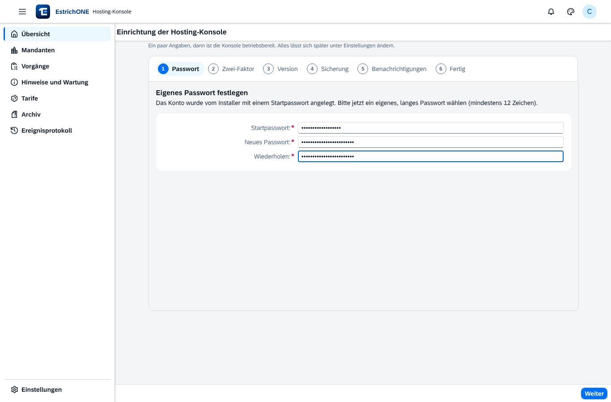
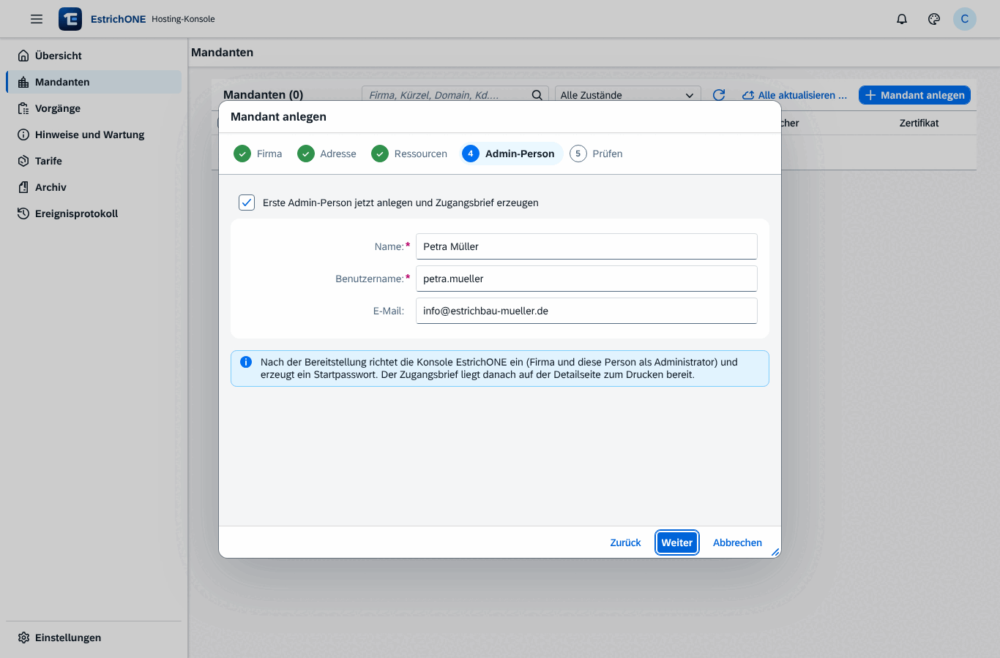
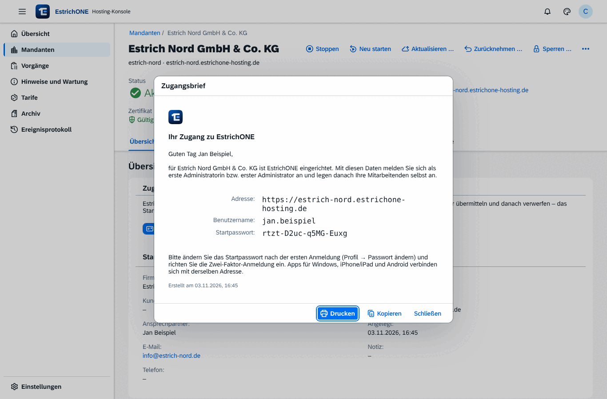
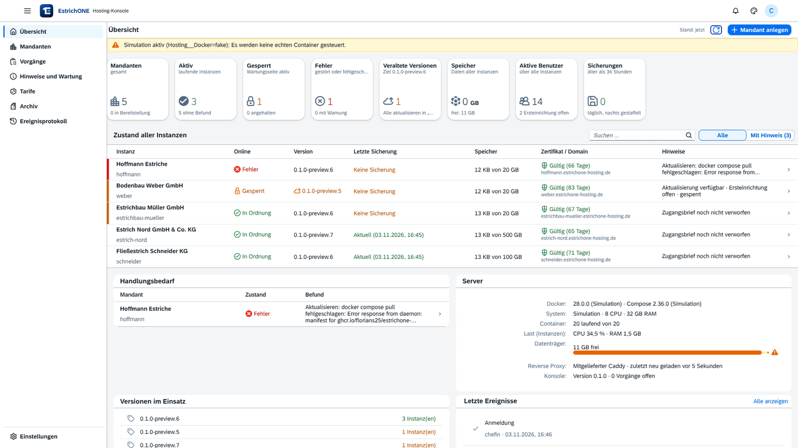
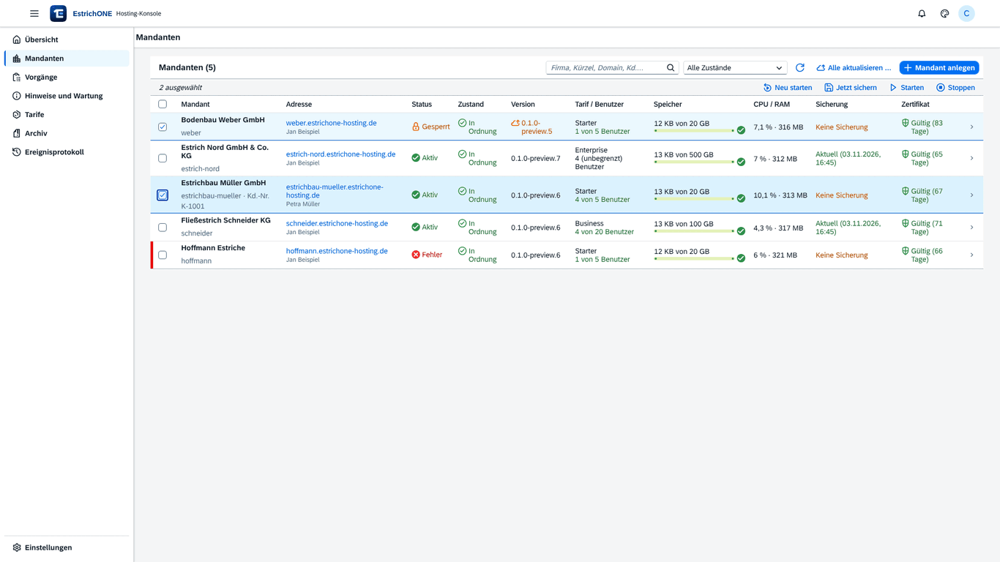
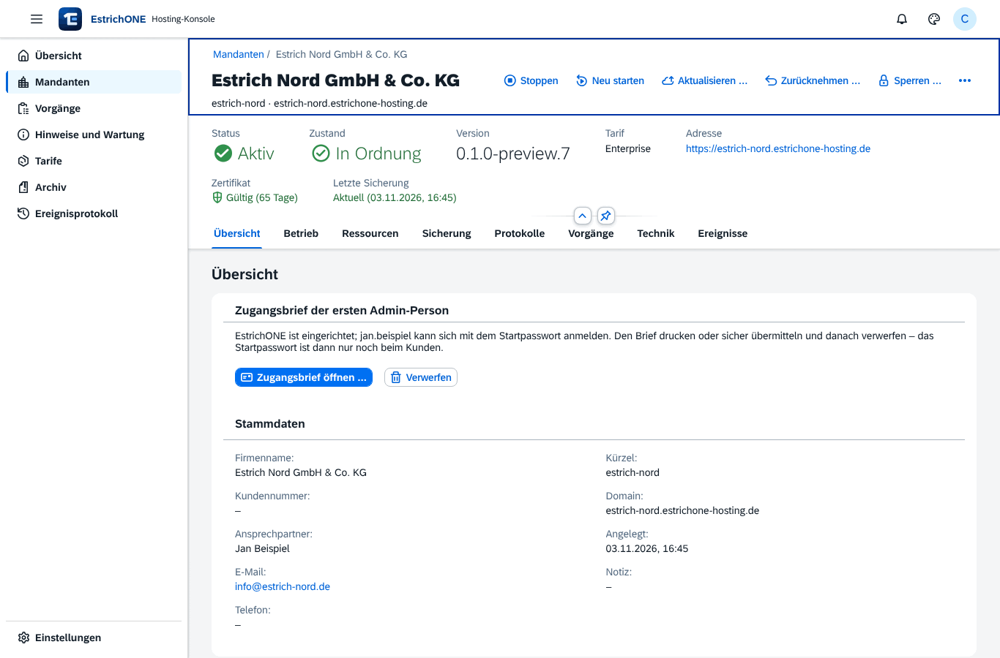
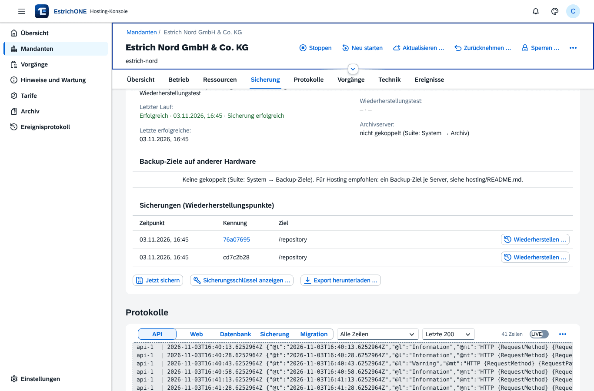

# EstrichONE Hosting-Konsole

Verwaltungskonsole für einen Hosting-Server, der viele EstrichONE-Instanzen (Mandanten) betreibt. Jede Instanz ist ein
eigenes Docker-Compose-Projekt `estrichone-<kürzel>` mit eigenem Verzeichnis, eigener `.env`, zufälligen Passwörtern und
eigenen Netzen. Ein gemeinsamer Reverse Proxy (mitgelieferter Caddy) verteilt die Anfragen per Domain; die Instanzen
veröffentlichen keine Ports.

```
Internet ──80/443──▶ Caddy (estrichone-hosting-proxy) ──┬─ konsole.<basis>     ▶ Konsole (estrichone-hosting-console)
                                                        ├─ firma-a.<basis>     ▶ estrichone-firma-a-caddy-1:8181 (Netz estrichone-firma-a-edge)
                                                        └─ firma-b.example.de  ▶ estrichone-firma-b-caddy-1:8181 (Netz estrichone-firma-b-edge)
```

## Installation – ein Befehl

```bash
curl -fsSL https://raw.githubusercontent.com/florians25/EstrichONE/main/hosting/install.sh | sudo bash
```

Der Assistent fragt mit sinnvollen Vorschlägen ab (Enter übernimmt den Vorschlag):

| Frage | Vorschlag | Bedeutung |
|---|---|---|
| Datenverzeichnis | `/srv/estrichone-hosting` | Instanzen, Sicherungen, Konsole (gleicher Pfad im Container) |
| Basis-Domain | Domain des Servers | Instanzen erhalten `<kürzel>.<basis-domain>` (Wildcard-DNS) |
| Adresse der Konsole | `konsole.<basis-domain>` | |
| Betriebsart | `direkt` | **direkt** = eigenes HTTPS auf 80/443 (mitgelieferter Caddy, Let's Encrypt) · **proxy** = hinter vorhandenem Proxy (z. B. Nginx Proxy Manager) – wie beim Suite-Installer |
| Zertifikate | `acme` | Let's Encrypt; `internal` = eigene CA (Test), `off` = nur HTTP |
| E-Mail | – | für Let's Encrypt und als Empfänger der Benachrichtigungen |
| Administrator | `admin` | erstes Konto; das **Startpasswort** erzeugt der Installer |

Fehlt Docker, bietet der Installer die Installation über get.docker.com an. Am Ende steht alles Nötige auf einen Blick:

```
  ───────────────────────────────────────────────────────────────────────────────
  EstrichONE Hosting-Konsole läuft (ghcr.io/florians25/estrichone-hosting:latest)
  ───────────────────────────────────────────────────────────────────────────────
  Adresse:      https://konsole.estrichone-hosting.de
  Notzugang:    http://127.0.0.1:8099  (nur auf dem Server bzw. per SSH-Tunnel …)
  Benutzer:     admin
  Startpasswort: k7Qm-Xa2p-RtZ9-wH4n
  Daten:        /srv/estrichone-hosting  (.env nur für root lesbar …)
  ───────────────────────────────────────────────────────────────────────────────
  Nächste Schritte:
   1. DNS: A/AAAA für konsole.… und Wildcard *.… auf diesen Server.
   2. Ports 80 und 443 (TCP, 443 auch UDP) in der Firewall freigeben …
   3. Konsole öffnen, anmelden, Einrichtungsassistent abschließen, erste Instanz anlegen.
```

**Ohne Rückfragen** (Automatisierung, CI): alle Antworten als Umgebungsvariablen, z. B.
`curl -fsSL …/install.sh | sudo HOSTING_BASE_DOMAIN=estrichone-hosting.de HOSTING_ACME_EMAIL=admin@firma.de bash`.
Weitere: `HOSTING_MODE`, `HOSTING_CONSOLE_DOMAIN`, `HOSTING_ROOT`, `HOSTING_ADMIN_USER`, `HOSTING_ADMIN_EMAIL`,
`HOSTING_ADMIN_PASSWORD`, `HOSTING_TLS`, `HOSTING_HTTP_PORT`, `HOSTING_HTTPS_PORT`, `HOSTING_VERSION`,
`HOSTING_ALLOWED_NETWORKS`, `HOSTING_INSTALL_DOCKER=1` (siehe Kopf von `install.sh` und `deploy/env.example`).

Gleichwertig ohne Skript direkt mit Docker:

```bash
sudo docker run --rm -it -v /var/run/docker.sock:/var/run/docker.sock \
  -v /srv/estrichone-hosting:/srv/estrichone-hosting ghcr.io/florians25/estrichone-hosting:latest install
```

### Verwalten, aktualisieren, reparieren, entfernen

Der Installer richtet den Befehl `estrichone-hosting` auf dem Server ein:

| Befehl | Wirkung |
|---|---|
| `sudo estrichone-hosting` | erneut ausführen = **Reparatur**: Compose-Datei, Verzeichnisse, Rechte, Container; `.env`, Konten und Instanzen bleiben |
| `sudo estrichone-hosting update [VERSION]` | Konsole auf `latest` bzw. VERSION aktualisieren (auch per Knopf: Einstellungen → System → „Konsole aktualisieren“) |
| `sudo estrichone-hosting status` | Container, Health und Zahl der Instanzen |
| `sudo estrichone-hosting logs` | Protokoll der Konsole live |
| `sudo estrichone-hosting reset-admin [BENUTZER]` | Notfall: neues Startpasswort, Zwei-Faktor aus, alle Sitzungen beendet |
| `sudo estrichone-hosting uninstall` | Konsole und Proxy entfernen; Instanzen und Daten bleiben (erneut installieren stellt alles wieder her) |
| `sudo estrichone-hosting uninstall --purge` | zusätzlich **alle Instanzen, Datenbanken und Sicherungen** löschen (Bestätigung „LÖSCHEN“) |

## Erste Anmeldung: Einrichtungsassistent



Nach der ersten Anmeldung mit dem Startpasswort führt die Konsole durch:

1. **Passwort** – eigenes Passwort (Pflicht bei Konten aus dem Installer, mindestens 12 Zeichen).
2. **Zwei-Faktor** (optional, empfohlen) – QR-Code für Authenticator-Apps.
3. **Standardversion** der Suite für neue Instanzen (Liste aus der Registry).
4. **Sicherung** – optional ein zweites Sicherungsziel außerhalb des Servers (restic: `sftp:…`, `rest:https://…`, `s3:…`,
   `b2:…`, `azure:…`, `gs:…`, `rclone:…`); je Instanz entsteht dort ein Unterordner, eingetragen als `BACKUP_REPOSITORY_2`.
5. **Benachrichtigungen** – E-Mail (SMTP mit STARTTLS) und/oder Webhook (JSON mit `text`, passend für Slack/Mattermost/Teams),
   mit Testnachricht.

Alles bleibt unter **Einstellungen** änderbar (System, Benachrichtigungen; Assistent erneut öffnen).

## Mandant anlegen (Assistent)



**Mandanten → Mandant anlegen** (auch auf der Übersicht) führt in fünf Schritten durch:

1. **Firma** – Name, Kundennummer, Ansprechpartner, E-Mail, Telefon, Notiz.
2. **Adresse** – Kürzel (aus dem Firmennamen vorgeschlagen) und Subdomain `<kürzel>.<basis>` oder eigene Kunden-Domain
   (Hinweis auf den nötigen CNAME).
3. **Ressourcen** – Tarif mit Benutzer-, Speicher-, RAM- und CPU-Grenze; Version.
4. **Erste Admin-Person** – Name, Benutzername (aus dem Namen vorgeschlagen), E-Mail.
5. **Prüfen und anlegen**.

Die Konsole legt Verzeichnis, `.env` mit Zufallspasswörtern, Netze und Proxy-Eintrag an, lädt die Images, startet die
Instanz und richtet EstrichONE über dessen Ersteinrichtungs-API ein (Firma + erste Admin-Person mit Startpasswort).
Auf der Detailseite liegt danach der **Zugangsbrief** (Adresse, Benutzername, Startpasswort – Öffnen nur nach erneuter
Passwortabfrage, druckbar, kopierbar); nach der Übergabe „Verwerfen“. Ohne Admin-Person zeigt die Detailseite wie bisher
den **Einrichtungscode**, mit dem der Kunde selbst einrichtet.



## Übersicht und Mandantenliste



- **Übersicht**: Kennzahlen, **Zustand aller Instanzen** (online, Version, letzte Sicherung, Speicher, Zertifikat und
  Domain, Hinweise; Probleme zuerst; Suche und Filter „Mit Hinweis“), Handlungsbedarf, Server, Versionen, Ereignisse.
- **Mandanten**: Suche (Firma, Kürzel, Domain, Kd.-Nr.), Filter (Zustand, Fehler, veraltet, Sicherung, Zertifikat),
  Spalten bis Zertifikat; **Massenaktionen** für ausgewählte Instanzen (neu starten, jetzt sichern, starten, stoppen) und
  **Alle aktualisieren** (mit Vorab-Sicherung).
- **Glocke** in der Kopfzeile: offene **Benachrichtigungen** (gestörte Instanz, Sicherung nicht aktuell,
  Speicherkontingent, Zertifikat läuft ab/fehlt, Vorgang fehlgeschlagen, Docker nicht erreichbar, Speicherplatz knapp).
  Ein Befund muss zwei Prüfungen (je 1 Minute) bestehen; Zustellung per E-Mail/Webhook beim Auftreten und beim Beheben.



## Instanz im Betrieb (Detailseite)



| Bereich | Funktionen |
|---|---|
| Kopf | Starten, Stoppen, Neu starten, **Aktualisieren** (Version wählen, Vorab-Sicherung), **Zurücknehmen**, Sperren/Entsperren, **Ankündigung** und **Wartung planen** nur für diese Instanz, Bearbeiten, Löschen |
| Übersicht | Zugangsbrief, Einrichtungscode bzw. „Erste Admin-Person jetzt anlegen“, Stammdaten |
| Betrieb | Container mit Health, CPU, RAM; `/health/ready`, Serverversion; **Domain und Zertifikat** (DNS-Auflösung, Aussteller, gültig bis – echter TLS-Handshake am Proxy, stündlich, bei Problemen alle 5 Minuten) |
| Ressourcen | Speicher gegen Kontingent, aktive Benutzer gegen Tarif, CPU/RAM |
| Sicherung | letzter Lauf, Prüfung, Wiederherstellungstest, Archivserver, Backup-Ziele; **Wiederherstellungspunkte** mit „Wiederherstellen …“; Jetzt sichern; Sicherungsschlüssel; **Export herunterladen** |
| Protokolle, Vorgänge, Technik, Ereignisse | Logs je Dienst mit Filter/Live/Download, Vorgangsprotokolle, Compose-Projekt und Proxy-Ziel, Audit |



**Aktualisieren mit Rücknahme:** Vor dem Wechsel sichert die Konsole die Instanz und merkt sich diesen Snapshot. Startet
die neue Version nicht (`docker compose up --wait` scheitert), nimmt die Konsole die Aktualisierung **automatisch**
zurück: alte Version, Datenbank und Dateien aus der Vorab-Sicherung, Start – der Vorgang ist „fehlgeschlagen“, die
Instanz läuft wieder. Nach einer erfolgreichen Aktualisierung bleibt **Zurücknehmen** verfügbar (gleicher Ablauf per
Knopf), bis zur nächsten Aktualisierung.

**Wiederherstellen:** beliebigen Wiederherstellungspunkt wählen; die Konsole sichert vorher den aktuellen Stand, hält
API, Web und Sicherung an, spielt mit dem Dienst `restore` der Suite Datenbank (Tausch über eine neue Datenbank) und
Dateien zurück und startet die Instanz.

**Export und Archiv:** „Export herunterladen“ liefert nach Passwortabfrage ein tar.gz mit Sicherungs-Repository,
Schlüsseldatei (`instanz.env`) und Compose-Dateien (Einmal-Link, 10 Minuten gültig). Löschen mit **Endsicherung** legt
dasselbe im **Archiv** ab (Seite „Archiv“: herunterladen, endgültig löschen mit Namensbestätigung). Wiederherstellen auf
einem beliebigen Server mit dem Suite-Installer (Modus „restore“).

## Weitere Funktionen

- **Hinweise und Wartung**: Ankündigungen (Titel, Text, Schweregrad, Zeitraum) und Wartungsfenster (Administratoren
  dürfen weiterarbeiten) an einzelne, ausgewählte oder alle Instanzen; die Suite zeigt sie als Banner bzw. Wartungsseite.
- **Tarife**: Benutzer- und Speicherlimit (überwacht), RAM- und CPU-Grenze für die API (durchgesetzt), Preis.
- **Ereignisprotokoll** aller Aktionen (Konsole und Installer) mit Suche, Zeitraum, Ergebnisfilter, CSV-Export.
- **Sicherheit**: eigene Administratoren (PBKDF2, `__Host-`-Cookie, CSRF, Rate-Limit, Kontosperre, TOTP), Passwortabfrage
  vor Zugangsbrief/Export/Schlüssel, strikte CSP, optionale IP-Allowlist (siehe unten).
- **Oberfläche**: OpenUI5 (self-hosted), alle Themes mit „Systemeinstellung folgen“, nur das EstrichONE-Logo.

## Voraussetzungen

- Linux-Server mit Docker Engine ≥ 24 und Compose-Plugin (sonst installiert der Installer Docker); je Instanz grob 1 GB
  RAM und 0,5 vCPU zusätzlich.
- Betriebsart **direkt**: Ports **80 und 443** frei. Betriebsart **proxy**: vorhandener Reverse Proxy (siehe unten).
- **DNS**: A/AAAA-Eintrag für die Konsolen-Domain und ein **Wildcard-Eintrag** `*.<basis-domain>` auf den Server.
  Eigene Kunden-Domains per CNAME auf `<kürzel>.<basis-domain>`. Zertifikate holt Caddy automatisch (Let's Encrypt).
- Viele Instanzen: jede braucht drei Docker-Netze. Für mehr als ~80 Instanzen in `/etc/docker/daemon.json` z. B.
  `"default-address-pools":[{"base":"10.200.0.0/14","size":24}]` setzen und Docker neu starten.

| Pfad | Inhalt |
|---|---|
| `/srv/estrichone-hosting/instances/<kürzel>/` | Compose-Dateien, `.env` (Passwörter, Sicherungsschlüssel), `zugang.json` (bis zum Verwerfen), `data/`, `backup-repository/` |
| `/srv/estrichone-hosting/proxy/` | von der Konsole erzeugtes Caddyfile und Wartungsseite |
| `/srv/estrichone-hosting/console/` | Datenbank der Konsole (SQLite), Sitzungsschlüssel – nur root |
| `/srv/estrichone-hosting/archive/` | Endsicherungen gelöschter Mandanten (restic-Repository + `instanz.env`) |
| `/etc/estrichone-hosting.conf`, `/usr/local/bin/estrichone-hosting` | Datenverzeichnis und Verwaltungsbefehl (vom Installer) |

| Port | Zweck |
|---|---|
| 80 / 443 (TCP, 443 auch UDP) | gemeinsamer Caddy: Konsole und alle Instanzen, HTTPS |
| 127.0.0.1:8099 | Notzugang zur Konsole direkt auf dem Server (SSH-Tunnel) |

## Anbindung an einen vorhandenen Proxy (Nginx Proxy Manager)

Installer mit Betriebsart `proxy` (`HOSTING_MODE=proxy`) und `HOSTING_PROXY_CONTAINER=<name des NPM-Containers>` ausführen. Der Caddy der
Konsole wird dann nicht gestartet; die Konsole verbindet den NPM-Container mit jedem Instanznetz. Je Mandant in NPM
einen Proxy Host anlegen: Domain → `http://estrichone-<kürzel>-caddy-1:8181` (Detailseite → Technik → Proxy-Ziel),
SSL mit Let's Encrypt und **Force SSL**, unter Advanced `client_max_body_size 600m;`. Für die Konsole:
`docker network connect estrichone-hosting <npm-container>` und Proxy Host → `http://estrichone-hosting-console:8080`.
Sperren hält in diesem Modus die Weboberfläche der Instanz an (keine eigene Wartungsseite).

## Sicherheitshinweise

- Der Docker-Socket ist nur im Konsolen-Container eingebunden; wer die Konsole bedient, kann den Host steuern.
  Konsole nur Administratoren zugänglich machen, 2FA einschalten.
- Optionale **IP-Allowlist**: `HOSTING_ALLOWED_NETWORKS=203.0.113.7,10.0.0.0/8` in der `.env` (bzw. beim Installer
  `-e HOSTING_ALLOWED_NETWORKS=…`) – andere Adressen erhalten 403, auch für Anmeldung und Oberfläche. Gilt hinter dem
  mitgelieferten Caddy bzw. Nginx Proxy Manager (private Netze) für die echte Client-Adresse; `127.0.0.1` (SSH-Tunnel
  auf Port 8099) bleibt als Notzugang immer erlaubt. Ungültige Einträge verhindern den Start (Protokoll prüfen).
- `.env` der Konsole und jeder Instanz nur für root lesbar (0600, der Installer zieht das bei jedem Lauf nach).
- Docker wird ohne Shell mit Argumentlisten aufgerufen; Kürzel, Domains und Versionen werden streng geprüft.
- Der Konsolen-Container läuft schreibgeschützt mit minimalen Capabilities (CHOWN, DAC_OVERRIDE, DAC_READ_SEARCH,
  FOWNER), um Datenverzeichnisse der Instanzen (UID 1654) anzulegen, zu messen und zu löschen.
- Die `.env` jeder Instanz enthält Datenbank-, Sicherungs- und Hinweis-Schlüssel – in Server-Backups verschlüsselt sichern.

## Entwicklung

```bash
cd hosting
dotnet test --solution EstrichOne.Hosting.slnx          # Unit- und Integrationstests (simulierter Docker)
cd ui && npm ci && npm run build                          # Oberfläche → ui/dist (in wwwroot kopieren)
Hosting__Docker=fake Hosting__Root=/tmp/hosting dotnet run --project ../src/EstrichOne.Hosting   # Simulation
npx playwright test                                       # E2E gegen http://localhost:5090
IMAGE=estrichone/hosting:ci hosting/scripts/integration.sh  # echter Test: Ein-Befehl-Installation, Assistent, Update/Rücknahme, Restore, Deinstallation
```

## Archivserver und Backup-Ziele je Mandant

Jede Instanz koppelt ihren Archivserver bzw. ihre Backup-Ziele selbst (Suite: System → Archiv, System → Backup-Ziele).
Die Konsole zeigt je Mandant unter **Sicherung**: Archivserver (gekoppelt, Anzahl archiviert/wartend/fehlgeschlagen,
letzter Fehler) und alle Backup-Ziele mit dem Ergebnis der letzten Sicherung dorthin. Quelle sind die Dateien im
Statusverzeichnis der Instanz (`data/backup-status/archive.json`, `targets/*.conf`, `target-*.json`) – ohne Zugriff
auf die Datenbank und ohne Zugangsdaten auszulesen.

Empfehlung für Hosting:

- **Backup-Ziel:** ein eigener Rechner (oder Speicher-VM) im Rechenzentrum mit
  `ghcr.io/florians25/estrichone-installer:latest backup-ziel`. Jede Instanz koppelt sich mit einem eigenen Code
  (`sudo docker exec estrichone-backup-target estrichone-archive pair` erzeugt den nächsten) und bekommt ein eigenes,
  nur für sie lesbares Repository (nur anhängen).
- **Archivserver:** pro Kunde ein eigener Archivserver oder ein gemeinsamer mit je einem Code pro Instanz; die
  Ablage ist je gekoppelter Instanz getrennt, das Journal gemeinsam (enthält nur Kennungen und Prüfsummen).
- Die Instanzen erreichen die Ziele über das Netz `estrichone-<kürzel>-edge`/`frontend` (ausgehend). Adresse beim
  Koppeln: interne IP oder Name des Zielrechners, Port 8443.
